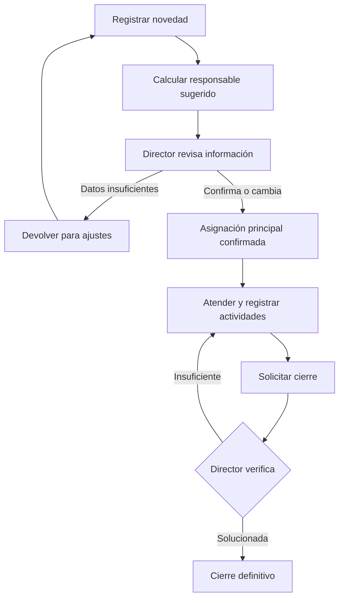
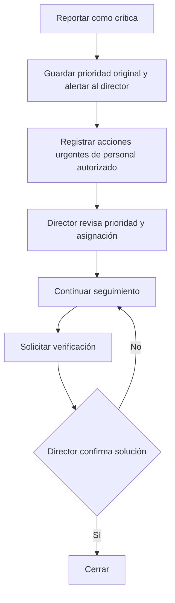

# EG S.A.S. — Roles y operación de novedades

**Extracto temático del documento maestro v2.2 (15/10/2026).** Las decisiones pendientes y sustituciones se encuentran en `07_DECISIONES_Y_PENDIENTES.md`.

## 4. Actores, roles y permisos

### 4.1 Roles de negocio

| Rol | Alcance y responsabilidad |
|---|---|
| **Gerente** | Crear novedades, supervisar propiedades y gestión interna, registrar observaciones, consultar tableros e informes, elaborar borradores autorizados. No aprueba ni distribuye informes oficialmente, no cierra novedades. |
| **Auxiliar de Gerencia** | Apoyo a Gerencia, registro y seguimiento dentro de permisos otorgados; acceso no necesariamente idéntico al gerente. No aprueba ni distribuye oficialmente. |
| **Director operativo** | Revisa novedades, confirma o modifica su responsable principal, supervisa actividades, cambia prioridades con trazabilidad, verifica y cierra/reabre novedades; revisa, devuelve, aprueba y distribuye oficialmente informes. Personaliza opciones permitidas de plantillas por propiedad. |
| **Coordinador operativo** | Registra novedades, aporta evidencias, atiende asignaciones, crea y distribuye actividades de sus casos, registra avances, solicita cierre y elabora informes de sus propiedades autorizadas. |
| **Administrador del sistema** | Configura cuentas, roles, permisos, catálogos y plantilla institucional. Este rol técnico no confiere automáticamente acceso a información operativa confidencial. |
| **Participante interno autorizado** | Puede atender actividades asignadas y registrar avances/evidencias, si su acceso ha sido otorgado. Su alcance exacto es propuesta técnica derivada del concepto de participantes. |
| **Técnico/proveedor externo** | Puede figurar como tercero relacionado con la intervención, **sin cuenta ni acceso** en el MVP. El responsable interno documenta su trabajo. |

### 4.2 Principios de control de acceso

1. Las funciones se conceden por rol y permisos explícitos.
2. Cada usuario tiene acceso solo a las propiedades y áreas autorizadas; Gerencia tiene visibilidad general según las políticas de la empresa.
3. Una actividad interna asignada a un coordinador no abre automáticamente todas las novedades del área interna.
4. Director: único cierre definitivo y única aprobación/distribución oficial de informes.
5. Director: confirmación o reasignación del responsable principal de novedades.
6. Director y responsable principal: creación y asignación de actividades a usuarios autorizados.
7. El administrador de plantillas institucionales no puede alterar contenido histórico aprobado.
8. El permiso para descargar un PDF no equivale a autorización para distribución oficial; fuera de la aplicación se requerirá una política interna de uso documental.

### 4.3 Matriz de operaciones principales

| Operación | Gerente | Aux. Gerencia | Director | Coordinador | Admin. sistema |
|---|:---:|:---:|:---:|:---:|:---:|
| Crear novedad | Sí | **Por confirmar** | Sí | Sí | No por defecto |
| Marcar novedad inicialmente crítica | Sí | **Por confirmar** | Sí | Sí | No por defecto |
| Ver novedades propias/autorizadas | Sí | Sí | Sí | Sí | Solo permiso adicional |
| Confirmar responsable principal | No | No | **Sí** | No | No |
| Cambiar prioridad con motivo | Proponer | Proponer | **Sí** | Proponer | No |
| Crear actividades | Solo si es responsable principal | Solo si es responsable principal | Sí | Si es responsable principal | No |
| Asignar actividades | Solo si es responsable principal | Solo si es responsable principal | Sí | Si es responsable principal | No |
| Registrar avances propios | Sí, según acceso | Sí, según acceso | Sí | Sí | No |
| Solicitar cierre | Si es responsable principal | Si es responsable principal | Sí | Si es responsable principal | No |
| Cerrar/reabrir novedad | No | No | **Sí** | No | No |
| Elaborar borrador de informe | Sí | Sí, según acceso | Sí | Sí, según acceso | No por defecto |
| Revisar para aprobación | No | No | **Sí** | No | No |
| Aprobar informe | No | No | **Sí** | No | No |
| Distribución externa oficial | No | No | **Sí** | No | No |
| Plantilla institucional | No | No | No | No | **Sí** |
| Configuración por propiedad | No | No | **Sí** | No | No |

**Pendiente real:** inicialmente se confirmó que reportan *Gerencia, Director y Coordinadores*. El Auxiliar de Gerencia se incorporó después con permisos similares a Gerencia, pero no se confirmó expresamente su facultad para crear o marcar crítica una novedad. Debe validarse; no se concede por suposición.

## 5. Novedades: estructura y clasificación

### 5.1 Dos ámbitos distintos

| Campo | Novedad de propiedad | Novedad interna |
|---|---|---|
| Ámbito | `PROPIEDAD` | `INTERNA` |
| Referencia obligatoria | Propiedad existente y autorizada | Área interna existente y autorizada |
| Ubicación complementaria | Zona, equipo o punto de referencia (si corresponde) | Oficina, dependencia o ubicación interna (si corresponde) |
| Categorías | Catálogo operativo para propiedades | Catálogo interno configurable |
| Responsable sugerido | Coordinador principal de propiedad, si existe y está activo | Referente de área interna, si existe y está activo |
| Informes | Por propiedad o consolidado | Por área o consolidado |

No se creará una propiedad ficticia llamada «EG S.A.S.» para las novedades internas. A nivel de datos, cada novedad estará relacionada con **una propiedad o un área interna, nunca ambas**.

### 5.2 Categorías sugeridas (configurables, no cerradas)

- Propiedades: mantenimiento, aseo, jardinería, seguridad, administrativa, convivencia, otras.
- Internas: administrativa, operativa, tecnología, otras.
- Las categorías podrán activarse/desactivarse; deberán conservarse en reportes históricos aunque se retiren del catálogo activo.
- Cada categoría podrá establecer evidencias mínimas para solicitar cierre.

### 5.3 Datos de una novedad

**Obligatorios comunes:** código único, ámbito, título, descripción, categoría, prioridad inicial, creador, fecha/hora de registro, estado y propiedad **o** área interna. Algunos se generan automáticamente.

**Complementarios:** ubicación/zona, equipo, fotos iniciales, archivos, responsable sugerido, responsable principal confirmado, otros participantes, fecha prevista, descripción de impacto, causa, observaciones, vínculos a casos duplicados, motivo de descarte/reapertura.

**Regla de edición:** no se borran retroactivamente los valores históricos de estados, prioridad, asignaciones o cierres. Los cambios relevantes se registran como eventos auditables.

### 5.4 Prioridad y estado son independientes

| Prioridad | Criterio orientativo |
|---|---|
| Baja | Puede programarse sin urgencia. |
| Media | Requiere seguimiento ordinario. |
| Alta | Atención preferente; **en principio requiere asignación confirmada**. |
| Crítica | Riesgo o daño grave que exige reacción inmediata; habilita registro urgente previo a confirmación. |

Gerente, director y coordinador pueden clasificar inicialmente una novedad como crítica. Solo el director modifica formalmente la prioridad y deja motivo e historial. Una marca «crítica» no autoriza ejecutar tareas de riesgo sin competencia técnica ni saltarse controles financieros fuera de la aplicación.

### 5.5 Estados principales de la novedad

| Estado | Qué significa |
|---|---|
| `REGISTRADA` | Caso creado; se valida y propone responsable. |
| `EN_REVISION` | Director revisa y confirma o devuelve por datos insuficientes. |
| `ASIGNADA` | Director confirmó responsable principal. |
| `EN_ATENCION` | Se ejecutan actividades y se documentan avances. |
| `PENDIENTE_CIERRE` | El responsable informó solución y solicita verificación. |
| `CERRADA` | Director verificó y cerró definitivamente. |

**Condiciones adicionales que no conviene confundir con estados principales:** devuelta para ajustes, en espera externa, atención urgente iniciada, reabierta y descartada. Se implementarán como subestados, indicadores, eventos o transiciones controladas según diseño técnico; su representación exacta aún es propuesta.

## 6. Flujo de atención y asignación (TO-BE)

### 6.1 Flujo ordinario

1. El usuario autorizado crea el caso; la plataforma genera código y fecha/hora.
2. Propone un responsable según propiedad/área si existe un candidato activo y autorizado.
3. El director revisa datos, prioridad y sugerencia; confirma o cambia responsable principal.
4. El responsable principal organiza la atención, crea actividades y asigna participantes autorizados; el director puede intervenir.
5. Se registran avances, evidencias y eventuales esperas externas.
6. El responsable solicita cierre cuando se cumplan los requisitos de evidencia de la categoría.
7. El director verifica, cierra o devuelve la novedad para completar la atención.

### 6.2 Asignación mixta, casos particulares

| Caso | Comportamiento |
|---|---|
| Una propiedad con coordinador principal activo | Se propone como responsable; el director confirma o cambia. |
| Propiedad con varios coordinadores | Se propone el principal configurado o se solicita selección. |
| Propiedad sin coordinador | Queda pendiente de asignación hasta intervención del director. |
| Novedad interna con responsable de área | Se propone si está activo y autorizado. |
| Usuario sugerido inactivo/no autorizado | No se confirma automáticamente; el director debe seleccionar otro. |
| Reasignación posterior | Solo director para responsable principal, con motivo y evento de auditoría. |

La sugerencia nunca equivale a asignación final para los casos ordinarios.

### 6.3 Excepción de novedad crítica

- Pueden iniciarse **registros de atención inmediata** antes de la asignación formal.
- Es obligatorio guardar responsable de la acción, fecha, descripción y evidencia cuando exista.
- El director recibe una alerta y posteriormente confirma/rectifica prioridad y asignación, con motivo.
- La atención urgente no habilita permisos técnicos o financieros adicionales.
- Incluso una novedad crítica necesita revisión y cierre definitivo del director.
- Si se rebaja la prioridad, el historial urgente permanece.

### 6.4 Devoluciones, reaperturas y descartes

- **Devolución inicial:** el reporte carece de información suficiente; el creador o usuario indicado lo completa sin perder su historia.
- **Devolución de cierre:** el director no considera resuelto el caso o faltan evidencias; exige motivo y regresa a atención.
- **Reapertura:** solo director, con causa y evento de auditoría, después de un cierre.
- **Descarte:** solo acción autorizada por el director, con motivo; no cuenta como novedad solucionada.
- **Duplicados:** propuesta de vincularlos y conservar sus registros, sin eliminarlos; regla operativa exacta pendiente.

## 7. Actividades, seguimiento y evidencias

### 7.1 Diferencias entre objetos

- **Novedad:** situación principal con código, ámbito, prioridad, estado y responsable general.
- **Actividad:** acción o tarea vinculada a una novedad; puede tener responsable, estado, fechas y archivos propios.
- **Seguimiento:** comentario, decisión, avance o evento que explica qué pasó con la novedad o sus actividades.
- **Evidencia:** archivo o constancia asociado a novedad/actividad; se organiza según su finalidad.

**Ejemplo:** una electrobomba averiada corresponde a una novedad. Inspección, solicitud de visita, reparación y verificación son actividades de ese mismo caso. No se crean cuatro novedades distintas para esas gestiones.

### 7.2 Estados de actividad

| Estado | Significado | Condiciones |
|---|---|---|
| `PENDIENTE` | No iniciada. | Puede tener fecha objetivo. |
| `EN_CURSO` | Se está realizando. | Acepta avances, comentarios y adjuntos. |
| `BLOQUEADA` | No puede continuar. | Motivo obligatorio. |
| `COMPLETADA` | Se terminó la actividad. | Fecha real, usuario y resultado. |
| `CANCELADA` | Ya no procede. | Motivo obligatorio; no se elimina el historial. |

Una actividad completada no cierra automáticamente la novedad. Si todas las actividades están listas, el responsable principal solicita el cierre y el director verifica.

### 7.3 Creación y distribución de actividades

- El director y el responsable principal pueden crear y asignar actividades.
- Los destinatarios deben ser usuarios activos y autorizados para la novedad.
- El director supervisa y puede modificar, cancelar o reasignar actividades.
- Los participantes actualizan las actividades que tengan asignadas; no pueden reasignar el responsable principal de la novedad.
- Un proveedor/técnico externo puede figurar como ejecutor informado, sin credenciales de acceso en el MVP.
- Las reasignaciones conservan usuario anterior, nuevo responsable, autor del cambio y fecha.
- Las actividades podrán tener fechas previstas y reales. El director podrá revisar retrasos y bloqueos.

### 7.4 Historial de seguimiento

Se registrará automáticamente: creación, correcciones relevantes, clasificaciones críticas, cambios de prioridad, asignaciones/reasignaciones, cambios de estado, solicitudes de cierre, devoluciones, aprobación de cierre, reaperturas, descartes, creación/cambio de actividades y registros de documentos. Los comentarios manuales también guardarán autor y fecha.

La interfaz podrá mostrar una línea de tiempo cronológica con los eventos; debe distinguir textos escritos por un usuario de cambios automáticos del sistema. No se eliminarán silenciosamente comentarios ni eventos; la política de corrección y retención será auditada.

### 7.5 Evidencias y archivos

| Tipo | Uso |
|---|---|
| Inicial | Foto/documento del problema al reportarlo. |
| Ejecución | Avances e intervenciones durante la atención. |
| Final | Resultado que apoya la verificación del cierre. |
| Soporte | Cotización, diagnóstico técnico, comunicación u otro PDF/archivo relevante. |

Los documentos se relacionarán con la novedad o con una actividad concreta. Conservarán metadatos de autor, fecha, nombre y clase de archivo, además de controles de acceso. Se deben definir formatos, tamaños máximos y un proceso de carga fiable; **los límites numéricos siguen pendientes**.

### 7.6 Requisitos de evidencia para solicitar cierre

La evidencia exigida será **configurable por categoría**. Ejemplos propuestos, no parametrización aprobada:

| Categoría | Evidencia sugerida |
|---|---|
| Mantenimiento | Foto final y descripción del trabajo. |
| Aseo/jardinería | Foto del resultado. |
| Seguridad | Prueba documental o visual según la situación. |
| Administrativa | Resultado descrito; documento cuando corresponda. |
| Otra | Regla definida por el administrador autorizado. |

El sistema validará requisitos antes de enviar a cierre; el director, con criterio operativo, comprobará el resultado. Los cambios de configuración no deben alterar silenciosamente los criterios ya aplicados a solicitudes en revisión.

## 8. Notificaciones y panel de control

### 8.1 Eventos propuestos

| Evento | Destinatario |
|---|---|
| Novedad nueva | Director que deba revisar la asignación. |
| Novedad marcada crítica | Director, con aviso prioritario. |
| Asignación confirmada/reasignación | Responsable principal. |
| Actividad nueva o reasignada | Responsable de actividad. |
| Comentario con mención | Usuario mencionado y autorizado. |
| Reporte devuelto | Usuario encargado de corregirlo. |
| Solicitud de cierre | Director. |
| Solicitud de cierre devuelta | Responsable principal. |
| Novedad cerrada | Creador y responsable. |
| Actividad bloqueada/vencida | Responsable y director según configuración. |
| Informe enviado a revisión | Director. |
| Informe devuelto | Autor del borrador. |
| Informe aprobado | Autor y usuarios autorizados. |

**MVP:** bandeja y avisos internos. **Pendiente:** canal alterno confiable para alertas críticas (correo, push o mensajería), configuración y escalamiento si el director no responde. No se presume que un aviso mostrado en pantalla garantice su lectura.

### 8.2 Tableros

- **Gerencia:** novedades por ámbito/propiedad, abiertas al corte, prioridades, críticas, cierres, tiempos, pendientes y responsables.
- **Dirección:** por revisar, sin responsable, críticas, bloqueadas, en espera, pendientes de cierre, informes por aprobar.
- **Coordinador:** propiedades asignadas, «Mis novedades», actividades asignadas, próximas a vencer y solicitudes devueltas.
- **Administrador técnico:** catálogos, usuarios, permisos, plantillas y auditoría técnica; no vista indiscriminada de expedientes.

### 8.3 Indicadores y fórmulas preliminares

| Indicador | Regla de cálculo |
|---|---|
| Novedades registradas en periodo | Casos creados entre fecha inicial y final. |
| Novedades cerradas en periodo | Casos con evento de cierre durante el intervalo. |
| Abiertas a fecha de corte | Casos que, en el instante de corte, no estaban cerrados ni descartados. |
| Actividades completadas en periodo | Actividades con fecha de finalización real en intervalo. |
| Tiempo hasta primera atención | Primera acción de atención menos fecha de registro. |
| Tiempo hasta asignación | Primera confirmación menos fecha de registro. |
| Tiempo hasta cierre | Fecha de cierre menos fecha de registro, distinguiendo reaperturas. |
| Tiempo por estado | Diferencia entre eventos sucesivos de estado, dentro del intervalo considerado. |
| Novedades críticas | Casos marcados inicialmente críticos y/o críticos en algún momento; informar el criterio usado. |
| Porcentaje de cierre de cohorte | Casos creados en periodo que ya se cerraron / casos creados en periodo; fijar fecha de corte. |

**No mezclar poblaciones:** «registradas en septiembre» y «cerradas en septiembre» son cifras de cohortes diferentes; el cociente simple entre ellas no es necesariamente una tasa de solución. En una reapertura conviene distinguir *novedades únicas cerradas* de *eventos de cierre*. Los cálculos definitivos deberán incluir casos de prueba con periodos, zonas horarias y reaperturas.
