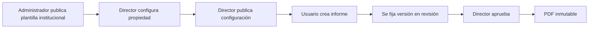

# EG S.A.S. — Informes, aprobaciones y plantillas

**Extracto temático del documento maestro v2.2 (15/10/2026).** Las decisiones pendientes y sustituciones se encuentran en `07_DECISIONES_Y_PENDIENTES.md`.

## 9. Módulo de informes

### 9.1 Tipos confirmados

1. **Propiedad:** informe de un edificio o conjunto para un periodo seleccionado, con novedades, actividad, evidencias, pendientes y observaciones.
2. **Gestión interna:** información de un área o conjunto de áreas internas autorizadas de EG S.A.S.
3. **Consolidado de Gerencia:** datos generales comparativos de propiedades y áreas, separados por ámbito cuando corresponda.

### 9.2 Elaboración: automático y editable

| Componente | Origen | Modificación desde el informe |
|---|---|---|
| Nombre de propiedad/área y periodo | Registro y filtros | Se elige al crear; no se reescribe en documento. |
| Novedades, estado, actividades, fechas, responsables | Base de datos e historial | **No editable**. |
| Indicadores y totales | Cálculos automáticos | **No editable**. |
| Selección de fotos/soportes a mostrar | Evidencias autorizadas | **Sí**, selección sin alterar origen. |
| Introducción | Autor del borrador | Sí. |
| Observaciones generales | Autor del borrador | Sí. |
| Recomendaciones | Autor del borrador | Sí. |
| Comentarios finales | Autor del borrador | Sí. |
| Identidad del aprobador y sello temporal | Sistema al aprobar | No. |

El usuario debe poder previsualizar el documento. La vista previa y el PDF aprobado se generarán a partir del mismo modelo de datos y motor de representación para reducir diferencias.

### 9.3 Estados y decisiones

| Estado | Acciones permitidas |
|---|---|
| `BORRADOR` | Editar textos, seleccionar evidencias y actualizar datos de origen explícitamente. |
| `EN_REVISION` | Ver documento congelado; el director aprueba o devuelve. Sin edición silenciosa. |
| `DEVUELTO` | Autor corrige, consulta observaciones y reenvía. |
| `APROBADO` | Documento oficial inmutable, publicado internamente para usuarios autorizados. Nueva corrección requiere versión nueva. |

La **publicación interna** ocurre automáticamente después de la aprobación; es un evento, no una segunda aprobación. **Distribuido** tampoco reemplaza al estado Aprobado: es una entrega vinculada a una versión concreta.

### 9.4 Responsabilidades exclusivas

- **Director operativo:** único revisor con facultad de aprobar/devolver, único aprobador de informes de todos los tipos y único usuario con función de distribución oficial externa.
- **Otros usuarios:** pueden elaborar y consultar según alcance autorizado, descargar cuando corresponda y agregar textos editables; no aprobar ni registrar distribución externa oficial.
- **Administrador técnico:** gestiona diseño institucional, sin acceso automático al contenido confidencial de informes.

### 9.5 Estructura base del informe de propiedad

1. Portada: identidad institucional y propiedad, título, periodo, versión.
2. Identificación: datos de propiedad, autor del informe, fecha de corte.
3. Introducción redactada (si se habilita).
4. Resumen: totales e indicadores con definiciones consistentes.
5. Relación de novedades: código, título, prioridad, estado, fechas y responsables.
6. Detalle de gestiones/actividades (opcional, con filtros definidos).
7. Evidencias seleccionadas y su descripción (opcional).
8. Novedades pendientes al corte y bloqueos (sección configurable, conservando resumen obligatorio de estados).
9. Observaciones y recomendaciones redactadas (si se habilitan).
10. Identificación de aprobación, fecha y control de versión.

Las versiones internas o consolidadas heredan identidad institucional, con estructura de contenido propia del ámbito.

### 9.6 Criterios de fechas y corte

- El periodo seleccionado limita los registros que aparecen según su fecha pertinente; el informe indicará el criterio en cada sección.
- La **fecha de corte** determina estados y pendientes a un momento concreto.
- Novedades iniciadas meses atrás pueden aparecer como cerradas en el periodo, sin cambiar su mes de registro.
- Cambios ocurridos después de que el borrador se envía a revisión no alteran automáticamente el contenido en revisión.
- Cuando un borrador requiere datos nuevos, debe ofrecer una acción explícita de actualizar, mostrando qué información cambiará.

### 9.7 Publicación y distribución

Solo se distribuyen oficialmente **versiones aprobadas**. El director registra destinatario, canal, fecha, versión exacta, responsable y observaciones/comprobante cuando aplique. La versión entregada conserva su PDF, aunque después se emita una nueva. Se distingue entre **registro manual de entrega** y un envío electrónico verificable; el MVP puede comenzar con la primera opción.

Los demás roles pueden descargar los PDF autorizados, pero la aplicación no puede impedir técnicamente que alguien reenvíe un archivo descargado. Esa limitación se cubre con autorización, auditoría y política interna de tratamiento de documentos, no con una promesa de control absoluto.

### 9.8 Versiones de documentos

1. **Versión de plantilla institucional:** estructura base publicada por el administrador.
2. **Versión de configuración por propiedad:** logo, encabezado, datos, secciones y presentación permitida; publicada por el director.
3. **Versión del informe:** instantánea de datos, textos, selecciones, evidencias y diseño; se aprueba y distribuye como documento fijo.

No se reemplazan PDFs aprobados; una corrección origina otra versión con motivo, fecha, autor y nueva aprobación. La aplicación conserva el informe anterior y sus distribuciones.

## 10. Plantillas institucionales y personalización

### 10.1 Autoridades

| Acción | Administrador | Director | Otros roles |
|---|:---:|:---:|:---:|
| Crear/modificar plantilla institucional | Sí | No | No |
| Publicar nueva versión institucional | Sí | No | No |
| Personalizar configuración de propiedad | No por defecto | Sí | No |
| Publicar configuración de propiedad | No por defecto | Sí | No |
| Editar textos de un informe propio autorizado | No por defecto | Sí | Según acceso |
| Modificar datos históricos desde plantilla | No | No | No |

### 10.2 Opciones por propiedad

- Logo de propiedad (opcional; si no existe, usar imagen/identidad institucional).
- Nombre, dirección, identificación registrada y datos de contacto autorizados.
- Secciones opcionales visibles y su orden dentro de límites institucionales.
- Opciones de disposición de imágenes (por ejemplo, una o dos por fila).
- Identificación y pie de página común; no se eliminan campos de control del documento.

### 10.3 Secciones inalterables y opcionales

**Obligatorias:** identificación del informe, ámbito/propiedad/área, periodo y fecha de corte, resumen de novedades y estados, identificador/versión, aprobador y fecha de aprobación en la versión final.

**Opcionales:** introducción, detalle extendido de actividades, galería fotográfica, pendientes detallados, observaciones generales, recomendaciones y comentarios finales. Ocultar una sección del PDF no elimina sus registros del sistema.

### 10.4 Flujo de configuración

La plantilla institucional, configuración por propiedad y documento final tienen historiales distintos. El cambio de plantilla no altera informes aprobados ni enviados a revisión. Los borradores podrán actualizarse expresamente a una nueva plantilla publicada.

### 10.5 Generación de PDF

Proceso propuesto: (1) elegir ámbito/periodo; (2) recuperar datos autorizados; (3) generar instantánea temporal; (4) resolver plantilla institucional y configuración particular; (5) construir vista previa; (6) enviar a director; (7) aprobar; (8) producir y conservar PDF inmutable; (9) habilitar descarga/registro de distribución. La selección concreta del motor PDF deberá probarse contra documentos con muchas fotografías, tablas extensas y caracteres en español.

El Excel será una **exportación de datos**, no una reproducción visual de la maqueta PDF. Se recomiendan hojas separadas de novedades, actividades y resumen, con columnas documentadas y filtros, sin replicar información financiera.
