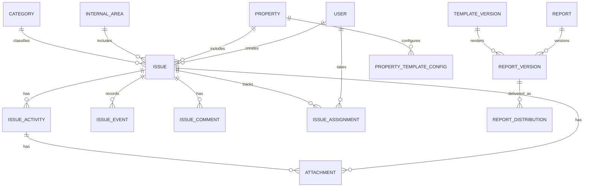

# EG S.A.S. — Pantallas, datos y arquitectura

**Extracto temático del documento maestro v2.2 (15/10/2026).** Las decisiones pendientes y sustituciones se encuentran en `07_DECISIONES_Y_PENDIENTES.md`.

## 11. Diseño de pantallas

Las pantallas siguientes representan una **propuesta de organización funcional**, no prototipos diseñados ni aplicaciones ya construidas.

### 11.1 Navegación general

```text
EG S.A.S. — Gestión de Novedades
├── Inicio / Tablero
├── Novedades
│   ├── Todas (según permisos)
│   ├── Mis novedades
│   ├── Pendientes de revisión
│   ├── Críticas / en espera / vencidas
│   ├── Nueva novedad
│   └── Detalle
│       ├── Resumen
│       ├── Actividades
│       ├── Evidencias y documentos
│       ├── Comentarios
│       └── Historial
├── Propiedades
│   ├── Catálogo, zonas y responsables
│   └── Configuración de informes (solo director)
├── Gestión interna
│   ├── Áreas
│   └── Novedades autorizadas
├── Informes
│   ├── Crear y previsualizar
│   ├── Mis borradores
│   ├── Por revisar / devueltos
│   ├── Aprobados / histórico
│   └── Distribuciones (solo director)
└── Configuración
    ├── Usuarios, roles, asignaciones y catálogos
    ├── Prioridades y evidencias por categoría
    ├── Plantilla institucional (solo admin)
    └── Auditoría técnica
```

### 11.2 Pantalla «Nueva novedad»

1. Elegir **Propiedad horizontal** o **Interna EG S.A.S.**.
2. Mostrar propiedad/zona o área interna según elección.
3. Completar título, descripción, categoría y prioridad; opcionalmente adjuntos iniciales.
4. Identificar al creador automáticamente y sugerir responsable si corresponde.
5. Si se marca crítica, mostrar aviso claro de atención inmediata y enviar alerta al director.
6. Permitir guardar y confirmar recepción; gestionar pérdida de señal sin duplicar registros.

### 11.3 Pantalla de detalle

Encabezado: código, título, ámbito, prioridad, estado, responsable principal y fechas. Secciones: descripción, actividades, comentarios, evidencias, eventos y solicitudes de cierre. Las acciones disponibles dependerán del rol, del estado y de la asignación.

### 11.4 Bandejas por usuario

- **Director:** registros por revisar, casos sin asignar, críticos, pendientes de cierre, informes en revisión.
- **Coordinador/responsable:** casos y actividades asignados, vencimientos, devoluciones, bloqueos.
- **Gerencia:** vista consolidada, casos críticos, análisis por propiedad y áreas.

### 11.5 Informes y plantillas

- Creador de informe: ámbito → destinatario interno (propiedad/área) → periodo → secciones → vista previa.
- Editor de borrador: textos redactados y selección de evidencias, manteniendo métricas bloqueadas.
- Revisión del director: PDF de vista previa, comentarios, devolver o aprobar.
- Histórico: versión, fecha, autor, aprobador, PDF oficial y entregas.
- Configuración de plantilla: campos institucionales gestionados por admin y configuración particular gestionada por director.

## 12. Modelo conceptual de datos

Este modelo es una **propuesta inicial**, no un esquema Prisma ni una migración aprobada. Los nombres pueden ajustarse al idioma y estilo de implementación, sin perder las relaciones.

### 12.1 Entidades

| Entidad | Información principal | Relación |
|---|---|---|
| `User` | Identificación interna, nombre, correo/login, estado activo | Roles, propiedades, áreas, acciones y tareas |
| `Role` / `Permission` | Rol y capacidad autorizada | Usuarios |
| `Property` | Nombre, datos identificativos, dirección, estado | Zonas, responsables, novedades, configuración PDF |
| `PropertyAssignment` | Usuario, propiedad, función, principal o apoyo | Control de acceso y sugerencias |
| `PropertyZone` | Zona/equipo/ubicación dentro de propiedad | Novedades |
| `InternalArea` | Nombre, referencia y responsable opcional | Novedades internas y permisos |
| `AreaAssignment` | Usuarios autorizados para área y función | Áreas/usuarios |
| `Category` | Ámbito, nombre, actividad, reglas de evidencia | Novedades |
| `ClosureEvidencePolicy` | Tipos de soporte requeridos y versión | Categorías/solicitudes de cierre |
| `Issue` | Código, ámbito, título, prioridad, estado, creador, fechas, propietario o área | Actividades, adjuntos, historial |
| `IssueAssignment` | Responsable, autor, motivo y vigencia | Novedad y usuarios |
| `IssueParticipant` | Participante interno con permiso | Novedad |
| `IssueActivity` | Título, descripción, responsable, estado, vencimiento y cierre | Novedad y eventos |
| `IssueComment` | Texto, creador, fecha, menciones | Novedad/actividad |
| `Attachment` | Tipo, propósito, clave de almacenamiento, autor, tamaño, hash | Novedad/actividad/informe |
| `IssueEvent` | Tipo de cambio, autor, instante, valores relevantes | Historial de la novedad |
| `Notification` | Destinatario, evento, leído, fecha | Usuarios y recursos |
| `Report` | Tipo, ámbito, periodo, creador, estado | Versiones y revisiones |
| `ReportVersion` | Instantánea, plantilla, versión, aprobador, archivo final | Informe, entregas |
| `ReportReview` | Revisión, observaciones, decisión | Informe/versión |
| `ReportDistribution` | Versión entregada, destinatario, canal, fecha, responsable | Informe aprobado |
| `TemplateVersion` | Plantilla institucional versionada y publicada | Informes |
| `PropertyTemplateConfig` | Personalización por propiedad, versión y publicación | Propiedad/plantilla |
| `AuditEvent` | Actor, acción, recurso, fecha, datos de cambio | Sistema completo |

### 12.2 Restricciones a proteger desde base de datos

- `Issue.scope = PROPIEDAD` exige `property_id` y prohíbe `internal_area_id`.
- `Issue.scope = INTERNA` exige `internal_area_id` y prohíbe `property_id`.
- Código de novedad único.
- Un responsable principal **vigente** por novedad, sin eliminar el historial de anteriores.
- No asignar participantes inactivos o no autorizados (validación de servicio transaccional).
- No permitir cierre definitivo fuera de la transición validada para director.
- Las evidencias y eventos históricos serán append-only o tendrán sustitución auditada.
- Una versión aprobada de informe es inmutable; la siguiente corrección crea otra versión.
- Las distribuciones apuntan a una **versión** de informe aprobada, no solo al informe lógico.
- La versión de plantilla/configuración usada para un informe queda fijada.
- No borrar en cascada registros operativos por retirar usuarios, categorías o propiedades; preferir desactivación.

### 12.3 Relaciones conceptuales



### 12.4 Auditoría y temporalidad

Se recomienda usar instantes de tiempo en UTC en la base de datos y convertir para visualización a la zona de EG S.A.S. (Colombia). Las fechas de corte deben interpretarse explícitamente. Los eventos importantes deben conservar el actor y un contexto verificable para reconstruir cambios.

## 13. Arquitectura técnica propuesta

### 13.1 Stack de referencia de las fuentes (aún por ratificar)

| Capa | Tecnología propuesta | Motivo |
|---|---|---|
| Frontend | Angular como PWA | Acceso desde navegador y celular, componentes y posibilidad de instalación. |
| Backend | NestJS con API REST | Separación de módulos, validaciones y políticas de autorización. |
| Base de datos | PostgreSQL | Integridad referencial y transacciones para estados, responsables y versiones. |
| Arquitectura de backend | Monolito modular | Separación de responsabilidades con despliegue sencillo. |
| Despliegue | Docker Compose, Nginx, HTTPS en VPS | Operación inicial contenida y centralizada. |
| Archivos | Almacenamiento privado en VPS o servicio de objetos equivalente | Fotografías, documentos y PDF accesibles solo por permisos. |
| Autenticación | Tokens/sesiones seguros, control de roles y permisos | Identificación de usuario y protección de recursos. |
| PDF | Motor HTML/CSS a PDF u otra biblioteca validada | Aprovechar plantillas y vista previa consistente. |

**Divergencia de fuentes:** el plan inicial propone Cloudinary para fotos y VPS para PDF. Otro informe también recoge almacenamiento híbrido. No está acordada una decisión final sobre proveedor, cuotas o política de alojamiento de imágenes. Es correcto conservar la alternativa como pendiente y no fijarla sin análisis de costos, privacidad y respaldos.

### 13.2 Separación modular recomendada

```text
backend/
├── identity-and-access
├── properties-and-areas
├── catalog-and-evidence-policies
├── issues
├── activities-and-comments
├── attachments
├── notifications
├── reporting-and-indicators
├── templates-and-report-versions
├── report-distribution
└── audit
```

La separación modular no implica necesariamente microservicios independientes. Las operaciones que afectan a varias tablas —por ejemplo, confirmación de asignación, solicitud de cierre o aprobación de informe— requieren transacciones y protección frente a solicitudes concurrentes.

### 13.3 Integraciones y almacenamiento

- Acceso autenticado a los archivos, sin enlaces públicos permanentes.
- Política de nombres/claves de almacenamiento, límites y validación de tipo real del archivo.
- Almacenamiento y base de datos respaldados de forma consistente; prueba periódica de restauración.
- Generación de informes fuera del proceso de petición si los PDF son grandes; proceso asíncrono y estado de generación como **propuesta de implementación**, no requisito comercial ya aprobado.
- Considerar límites de tamaño para fotografías desde celular y compresión sin perder evidencia relevante.
- Despliegue de pruebas separado del entorno productivo.

### 13.4 PWA y modo sin conexión

Las fuentes académicas incluyen un objetivo de diligenciar reportes sin conexión y sincronizarlos después. **No fue validado expresamente en la conversación de definición actual**. Se recomienda tratarlo como requisito propuesto y decidir si entra en el MVP; implementarlo correctamente requiere almacenamiento local seguro, reintentos idempotentes, prevención de duplicados y gestión de conflictos.

## 14. Requisitos no funcionales

| Código | Requisito | Estado |
|---|---|---|
| RNF-01 | Cifrado en tránsito (HTTPS), contraseñas almacenadas con hash resistente y autenticación segura. | Propuesto/consistente con fuentes |
| RNF-02 | Autorización por rol y alcance en backend, incluso si la interfaz oculta funciones. | Necesario por decisiones |
| RNF-03 | Protección de archivos y validación de cargas contra acceso indebido y contenido peligroso. | Propuesto |
| RNF-04 | Historial de auditoría de cambios sensibles, aprobaciones, cierres y distribución. | Confirmado funcionalmente |
| RNF-05 | Interfaz adaptable a computador y celular; navegación PWA. | Confirmado como enfoque |
| RNF-06 | Manejo de errores y recuperación de conexiones interrumpidas sin registros duplicados. | Propuesto |
| RNF-07 | Copias de seguridad de base de datos, evidencias, PDF y configuración, con pruebas de restauración. | Confirmado como necesidad |
| RNF-08 | Protección de datos personales y minimización de información recopilada. | Propuesto/necesario |
| RNF-09 | Disponibilidad, tiempos de respuesta y tamaño de archivos con metas medibles acordadas antes de pruebas. | **Valores pendientes** |
| RNF-10 | Monitoreo, registros de errores y observabilidad mínima de backend y generación de informes. | Propuesto |
| RNF-11 | Soporte de accesibilidad básica, contraste, teclado, mensajes claros y formularios utilizables. | Propuesto |
| RNF-12 | Configuración segura de servidor, copias y credenciales por ambiente. | Propuesto |
| RNF-13 | Inmutabilidad lógica de documentos aprobados y referencias a versiones de plantilla. | Confirmado funcionalmente |
| RNF-14 | Pruebas automatizadas de permisos, flujos, transiciones y generación de documentos. | Necesario para validación |
| RNF-15 | No almacenar ni procesar saldos, datos contables o pagos. | Restricción confirmada |
| RNF-16 | Política de conservación y eliminación legal de información por definir con EG S.A.S. | Pendiente |

No se establecen SLA, número de usuarios concurrentes, límites exactos ni plazos de retención sin datos de la operación real.
