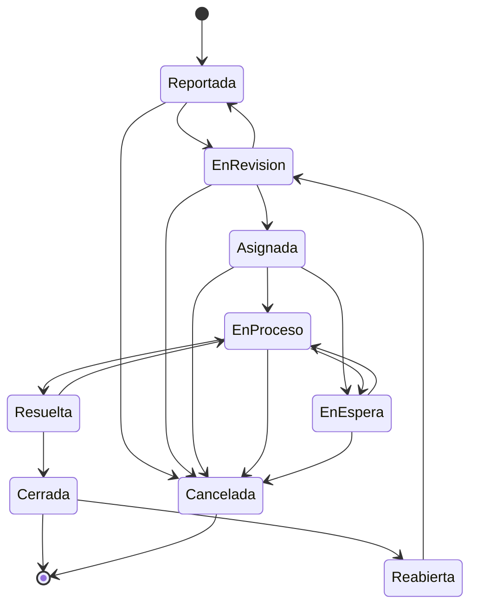
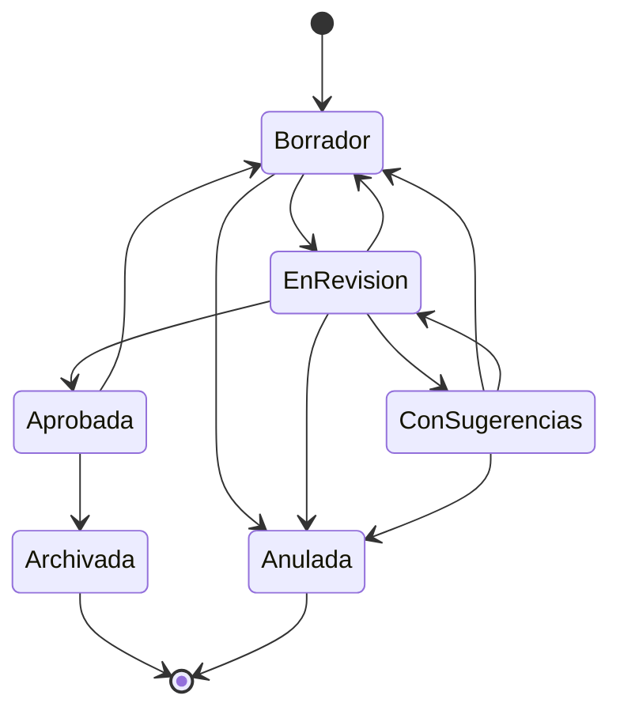
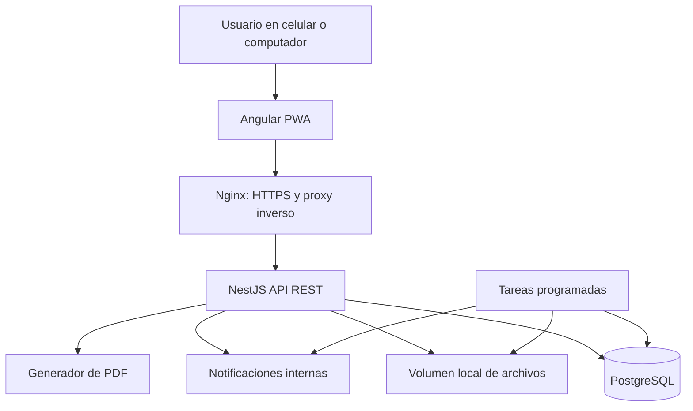

# Sistema de Gestión Operativa para Propiedades Horizontales

**Documento funcional y de arquitectura de software**  
**Versión:** 1.4  
**Fecha:** 10 de septiembre de 2026  
**Estado:** Propuesta para definición del MVP

## 1. Descripción del proyecto

La empresa administra varias propiedades horizontales en la ciudad de Montería. Cada propiedad, por ejemplo el **Edificio Sol**, tiene un director y un coordinador encargados de su gestión operativa. La gerente supervisa todas las propiedades y necesita consultar su información sin depender de mensajes, llamadas o documentos separados.

Durante las inspecciones se revisan luminarias, ascensores, electrobombas, piscinas, jardines, puertas eléctricas, sistemas eléctricos y otras zonas o equipos comunes. Cuando se encuentra un daño o una necesidad de mantenimiento, el coordinador toma fotografías y reporta la novedad. Actualmente, gran parte del seguimiento se realiza por WhatsApp, correo electrónico y comunicación directa.

Se propone desarrollar una **aplicación web progresiva (PWA)** para centralizar las novedades, las actas, las reuniones, los comentarios y los informes de cada propiedad.

### 1.1 Prototipo existente

Existe un prototipo construido en React con Vite que muestra pantallas de inicio, propiedades, novedades, actas, agenda, informes y auditoría. **Ese prototipo se usará únicamente como referencia visual y de navegación.** Su código no forma parte del producto y no se reutilizará.

En consecuencia:

- La pila definitiva es la descrita en la sección 14: Angular para la PWA y NestJS para la API.
- El prototipo aporta la disposición de pantallas, la jerarquía visual y el vocabulario de interfaz. No define el modelo de datos, las reglas del negocio ni la máquina de estados, que son los de este documento.
- Las funciones que aparecen en el prototipo y no están en la sección 5.1 no pertenecen al MVP. El Anexo A registra qué se decidió sobre cada una.

## 2. Problema que debe resolver

La información operativa está distribuida entre diferentes medios, lo que dificulta:

- Conocer las novedades abiertas y su estado actual.
- Identificar su prioridad y la persona responsable.
- Consultar fotografías, documentos, comentarios y cambios anteriores.
- Revisar las actas y las modificaciones sugeridas.
- Recordar reuniones y actividades programadas.
- Consultar la información de una propiedad específica.
- Supervisar todas las propiedades desde una sola vista.
- Generar informes confiables sobre la gestión realizada.

## 3. Objetivo general

Desarrollar una PWA que permita gestionar la operación de las propiedades horizontales, centralizando el registro y seguimiento de novedades, la elaboración y revisión de actas, la programación de reuniones, los comentarios internos y la generación de informes por propiedad.

## 4. Objetivos específicos

- Organizar las propiedades y sus responsables.
- Registrar novedades con prioridad, estado, evidencias y comentarios.
- Mantener el historial completo de cada novedad.
- Crear actas en borrador, recibir sugerencias y controlar sus versiones.
- Programar reuniones en una agenda interna.
- Mostrar recordatorios al usuario cuando ingrese al sistema.
- Permitir que la gerente consulte y comente la información de todas las propiedades.
- Generar informes individuales por propiedad y periodo.
- Preparar la base técnica para agregar nuevos módulos después del MVP.

## 5. Alcance del MVP

El MVP se concentrará únicamente en la gestión operativa. Contabilidad, Tesorería y el manejo financiero no formarán parte de esta primera versión.

### 5.1 Funciones incluidas

1. Inicio de sesión y recuperación de contraseña.
2. Administración de usuarios, roles y permisos.
3. Registro y administración de propiedades.
4. Asignación de director y coordinador a cada propiedad.
5. Registro, consulta y actualización de novedades.
6. Prioridades y estados configurados para las novedades.
7. Fotografías, documentos y comentarios asociados a una novedad.
8. Historial de responsables, estados y modificaciones.
9. Creación y edición de actas en estado borrador.
10. Versiones de las actas para conservar los cambios anteriores.
11. Sugerencias de modificación que puedan aceptarse o rechazarse.
12. Comentarios y respuestas dentro de novedades y actas.
13. Programación de reuniones en una agenda interna.
14. Recordatorios visibles al abrir la aplicación.
15. Informe general de cada propiedad.
16. Panel general para la gerente.
17. Registro de auditoría de las acciones sensibles.
18. Instalación de la aplicación como PWA en celular o computador.
19. Costo estimado de la novedad como dato informativo, sin flujo de aprobación.
20. Tipos de acta según el órgano que se reúne.
21. Aviso por correo electrónico de las novedades críticas y de las reuniones programadas.

### 5.2 Funciones excluidas del MVP

- Solicitudes de recursos.
- Aprobaciones contables.
- Entregas de dinero por Tesorería.
- Presupuestos, gastos y conciliaciones.
- Aprobación de costos y control de ejecución presupuestal por propiedad. El MVP solo registra el costo estimado como dato informativo.
- Integración con programas contables.
- Compras e inventario.
- Portal para propietarios o residentes.
- Aplicación móvil nativa.
- Sincronización con Google Calendar o Microsoft Outlook.
- Funcionamiento completo sin conexión.
- Análisis de actas con inteligencia artificial. El prototipo de referencia muestra sugerencias con fundamento legal generadas por un modelo de lenguaje; esa función no pertenece al MVP y las sugerencias las redactan las personas.
- Firma electrónica de actas y registro de quórum. El MVP conserva la aprobación por parte del director, con registro de usuario, fecha y huella del PDF.
- Notificaciones push en el dispositivo. El aviso fuera de la aplicación se cubre con correo electrónico.

Estas funciones podrán evaluarse cuando el MVP se encuentre estable y validado por los usuarios.

## 6. Roles del sistema

Los permisos se administrarán por acciones. Un rol define qué puede hacer el usuario y la asignación a una propiedad define sobre qué información puede hacerlo.

| Rol | Alcance | Responsabilidades |
| --- | --- | --- |
| Administrador | Todo el sistema | Crea usuarios, asigna roles, registra propiedades, asigna responsables y administra parámetros. |
| Gerente | Todas las propiedades | Consulta novedades, actas, reuniones e informes de todas las propiedades. Puede agregar comentarios y hacer seguimiento. |
| Director | Propiedades asignadas | Supervisa novedades, define o ajusta prioridades, asigna actividades, revisa actas, responde comentarios y valida cierres. |
| Coordinador | Propiedades asignadas | Registra novedades, adjunta evidencias, actualiza estados, redacta actas, atiende sugerencias y programa reuniones. |

### 6.1 Reglas de acceso

- La gerente puede consultar todas las propiedades y comentar en cualquier novedad o acta.
- Un director solo puede ingresar a las propiedades que tenga asignadas.
- Un coordinador solo puede trabajar en las propiedades que tenga asignadas.
- Cada propiedad tendrá un director y al menos un coordinador. El modelo permitirá asignar más de uno en el futuro sin cambiar la base de datos.
- El administrador gestiona la configuración, pero sus acciones también quedan registradas.
- Un usuario puede tener más de un rol si la empresa lo requiere.

#### Alcance del rol

Los roles Administrador y Gerente son **globales**: aplican a toda la organización. Los roles Director y Coordinador son **locales**: solo tienen efecto sobre las propiedades asignadas.

Para que un mismo usuario pueda ser director de una propiedad y coordinador de otra sin heredar permisos donde no corresponde, la tabla `user_roles` incluirá `property_id` anulable:

- `property_id` nulo: rol global (Administrador, Gerente).
- `property_id` con valor: rol local sobre esa propiedad (Director, Coordinador).

La verificación de cada acción evaluará siempre la pareja permiso + propiedad. Un permiso concedido por un rol local nunca se extiende a otra propiedad. La tabla `property_assignments` conserva la vigencia de la asignación operativa y su historial; `user_roles` conserva la capacidad de actuar.

## 7. Módulos funcionales

### 7.1 Usuarios y permisos

- Crear, editar, activar y desactivar usuarios.
- Asignar roles.
- Recuperar contraseña.
- Controlar permisos por acción y propiedad.
- Consultar el último acceso y el estado del usuario.

### 7.2 Propiedades

- Registrar los datos de identificación y de contacto de la propiedad.
- Asignar director y coordinador.
- Consultar el equipo responsable.
- Ver un resumen de novedades, actas y reuniones.
- Mantener el historial de asignaciones.
- Administrar el catálogo de áreas y equipos de la propiedad, que alimenta la ubicación de las novedades.

La versión anterior decía solamente "datos básicos". Para una propiedad horizontal los campos mínimos son:

| Campo | Observación |
| --- | --- |
| Nombre | Por ejemplo, Edificio Sol. |
| NIT | Identificación tributaria de la copropiedad. |
| Dirección, barrio y ciudad | — |
| Número de unidades privadas | Base para indicadores por unidad. |
| Tipo | Edificio, conjunto cerrado u otro. |
| Estado | Activa o inactiva. |
| Administrador o contacto principal y teléfono | — |
| Presidente del consejo de administración | Útil para actas y convocatorias. |
| Áreas y equipos comunes | Catálogo por propiedad: luminarias, ascensores, electrobombas, piscina, jardines, puertas eléctricas y demás. |
| Fecha de inicio de la administración | — |

### 7.3 Novedades

- Crear una novedad desde celular o computador.
- Seleccionar propiedad, categoría, ubicación y prioridad.
- Escribir una descripción clara del problema.
- Adjuntar fotografías o documentos.
- Asignar un responsable.
- Registrar un costo estimado en pesos, como dato informativo.
- Cambiar el estado siguiendo el flujo permitido.
- Agregar comentarios y responder a otros usuarios.
- Consultar la línea de tiempo completa.
- Cerrar o reabrir una novedad con justificación.

### 7.4 Actas

- Crear un acta asociada a una propiedad, indicando su tipo.
- Guardarla como borrador sin publicarla.
- Editar título, fecha, asistentes, temas tratados, compromisos y contenido.
- Guardar versiones para consultar cambios anteriores.
- Enviar el borrador a revisión.
- Seleccionar un fragmento o sección y proponer una modificación.
- Aceptar, rechazar o responder una sugerencia.
- Aprobar el acta y generar una versión final en PDF.
- Consultar actas por propiedad, tipo, fecha y estado.

#### Tipos de acta

| Tipo | Código técnico |
| --- | --- |
| Asamblea ordinaria | `ASAMBLEA_ORDINARIA` |
| Asamblea extraordinaria | `ASAMBLEA_EXTRAORDINARIA` |
| Consejo de administración | `CONSEJO_ADMINISTRACION` |
| Comité de convivencia | `COMITE_CONVIVENCIA` |

El tipo determina la plantilla de la que parte el borrador y los campos que el sistema pide antes de enviar a revisión. Los tipos son un catálogo administrable, no una lista fija en el código, para poder añadir otro órgano sin una migración.

El MVP no registra quórum ni firma electrónica. El acta se aprueba por parte del director y el PDF final conserva su huella SHA-256, tal como establece la sección 10.

### 7.5 Reuniones y agenda interna

- Programar una reunión con título, descripción, propiedad, fecha, hora, lugar o enlace.
- Seleccionar participantes entre los usuarios del sistema.
- Definir con cuánta anticipación debe aparecer el recordatorio.
- Consultar las reuniones en vista de calendario o lista.
- Mostrar al iniciar la aplicación las reuniones del día y las próximas.
- Marcar una reunión como realizada, cancelada o reprogramada.
- Relacionar una reunión con un acta cuando corresponda.

La agenda del MVP será interna. No enviará invitaciones externas ni modificará calendarios personales.

### 7.6 Comentarios

- Comentar una novedad o un acta.
- Responder comentarios.
- Mencionar a un usuario para generar una notificación.
- Editar un comentario durante un periodo corto y conservar registro del cambio.
- Marcar comentarios como resueltos cuando correspondan a una revisión.

### 7.7 Notificaciones internas

- Nueva novedad en una propiedad asignada.
- Cambio de estado o prioridad.
- Nuevo comentario o mención.
- Acta enviada a revisión.
- Nueva sugerencia o respuesta.
- Reunión próxima.
- Novedad sin actualización durante el tiempo configurado.

Las notificaciones se mostrarán en el encabezado y en el panel inicial. Cada usuario podrá marcarlas como leídas.

#### Alcance del canal de notificación

Conviene ser explícito sobre una limitación que condiciona la adopción del sistema. Si las notificaciones solo existen dentro de la aplicación y los recordatorios solo aparecen al abrirla, **una novedad crítica no llega a nadie que no abra la aplicación**. El equipo trabaja hoy con WhatsApp, donde el aviso llega al bolsillo. Pasar a un canal que exige entrar a consultar es un retroceso en ese punto concreto y el riesgo real es que se siga usando WhatsApp en paralelo.

Por eso el MVP incluye **correo electrónico**, además de la notificación interna. Las notificaciones push quedan fuera, según la sección 5.2.

#### Correos del MVP

| Situación | Destinatarios |
| --- | --- |
| Novedad registrada con prioridad crítica | Director de la propiedad y gerente |
| Novedad crítica sin atención después del umbral configurado | Director de la propiedad y gerente |
| Reunión programada, reprogramada o cancelada | Participantes de la reunión |
| Recordatorio de reunión según la anticipación configurada | Participantes de la reunión |
| Restablecimiento de contraseña | El propio usuario |

Reglas del envío:

- El correo complementa la notificación interna; no la reemplaza. Toda notificación enviada por correo existe también dentro de la aplicación.
- El envío es asíncrono y se encola. Si el servicio de correo falla, la operación del usuario se completa igual y el envío se reintenta; un fallo de correo nunca impide registrar una novedad.
- Cada intento se registra en `email_deliveries` con destinatario, asunto, estado y fecha, para poder demostrar que el aviso salió.
- El correo no transporta información sensible más allá de lo necesario: indica la propiedad, el código de la novedad y un enlace. El detalle se consulta dentro de la aplicación, previa autenticación.
- Cada usuario podrá desactivar los correos que no sean críticos. Los avisos de novedad crítica no son opcionales.
- El remitente usará un dominio propio con SPF, DKIM y DMARC configurados. Sin eso los correos llegan a la carpeta de no deseados y la función se vuelve inútil en la práctica.

### 7.8 Informes por propiedad

Cada propiedad tendrá un informe filtrable por periodo que incluya:

- Datos de la propiedad y responsables asignados.
- Total de novedades registradas.
- Novedades por estado, prioridad y categoría.
- Novedades abiertas, resueltas, cerradas y reabiertas.
- Tiempo promedio de atención y cierre.
- Novedades que llevan más tiempo sin actualización.
- Detalle de las novedades del periodo.
- Suma de los costos estimados del periodo, señalada como estimación informativa.
- Actas creadas, en revisión y aprobadas, discriminadas por tipo.
- Reuniones realizadas, canceladas y pendientes.
- Comentarios o actividades recientes relevantes.

El informe podrá consultarse en pantalla y exportarse en PDF. La gerente podrá comparar propiedades desde su panel general, pero el documento individual siempre corresponderá a una propiedad.

## 8. Casos de uso principales

| Código | Caso de uso | Actor principal | Resultado |
| --- | --- | --- | --- |
| CU-01 | Iniciar sesión | Todos | Acceso según rol y propiedades asignadas. |
| CU-02 | Administrar usuarios y roles | Administrador | Usuarios con permisos controlados. |
| CU-03 | Registrar una propiedad | Administrador | Propiedad disponible para su gestión. |
| CU-04 | Asignar director y coordinador | Administrador | Equipo responsable asociado a la propiedad. |
| CU-05 | Consultar panel general | Gerente | Resumen de todas las propiedades. |
| CU-06 | Registrar una novedad | Coordinador | Novedad creada con prioridad y evidencia. |
| CU-07 | Revisar una novedad | Director | Prioridad, responsable y seguimiento validados. |
| CU-08 | Actualizar el estado | Coordinador o director | Avance registrado en la línea de tiempo. |
| CU-09 | Comentar una novedad | Gerente, director o coordinador | Comentario y notificación guardados. |
| CU-10 | Cerrar o reabrir una novedad | Director | Cierre o reapertura con justificación. |
| CU-11 | Crear un acta en borrador | Coordinador | Acta editable asociada a una propiedad. |
| CU-12 | Sugerir una modificación | Gerente o director | Propuesta registrada sin alterar el texto original. |
| CU-13 | Resolver una sugerencia | Autor o usuario autorizado | Sugerencia aceptada, rechazada o respondida. |
| CU-14 | Aprobar un acta | Director | Versión final disponible para consulta y PDF. |
| CU-15 | Programar una reunión | Director o coordinador | Reunión incluida en la agenda interna. |
| CU-16 | Consultar recordatorios | Todos | Próximas reuniones visibles al ingresar. |
| CU-17 | Generar informe por propiedad | Gerente o director | Informe filtrado y exportable. |
| CU-18 | Consultar auditoría | Administrador | Historial de acciones sensibles. |
| CU-19 | Recuperar la contraseña | Todos | Restablecimiento mediante enlace de un solo uso. |
| CU-20 | Adjuntar una evidencia | Coordinador o director | Fotografía o documento asociado y verificado. |
| CU-21 | Descargar un archivo | Según permiso y propiedad | Entrega validada a través del backend. |
| CU-22 | Marcar notificaciones como leídas | Todos | Bandeja al día. |
| CU-23 | Reasignar el responsable de una novedad | Director | Cambio registrado en el historial. |

En CU-13, "usuario autorizado" corresponde al autor del acta y al director de la propiedad. La gerente propone sugerencias y responde, pero no las decide.

## 9. Flujo de las novedades

### 9.1 Prioridades

| Prioridad | Uso esperado |
| --- | --- |
| Baja | Puede atenderse dentro de la programación normal. |
| Media | Requiere seguimiento, pero no afecta de forma grave la operación. |
| Alta | Debe atenderse pronto porque afecta un servicio o una zona importante. |
| Crítica | Representa un riesgo para las personas, la seguridad o la continuidad de un servicio. |

La prioridad inicial la propone el coordinador. El director puede ajustarla y debe quedar registro del cambio.

### 9.2 Estados



Dos transiciones merecen explicación porque resuelven vacíos de la versión anterior:

- **`Resuelta → En proceso`:** el director revisa y comprueba que el problema no quedó solucionado. La novedad vuelve a ejecución con un motivo obligatorio, sin necesidad de cerrarla y reabrirla.
- **Cancelación desde cualquier estado no terminal:** una novedad puede descubrirse duplicada o improcedente después de haber iniciado su atención. La cancelación la ejecuta el director y exige motivo.

| Estado | Código técnico | Significado |
| --- | --- | --- |
| Reportada | `REPORTADA` | La novedad fue creada y está pendiente de revisión. |
| En revisión | `EN_REVISION` | El director está verificando la información y la prioridad. |
| Asignada | `ASIGNADA` | Existe una persona responsable de atenderla. |
| En proceso | `EN_PROCESO` | Se están realizando las actividades necesarias. |
| En espera | `EN_ESPERA` | El caso está detenido y debe tener una causa registrada. |
| Resuelta | `RESUELTA` | El responsable informa que el problema fue solucionado. |
| Cerrada | `CERRADA` | El director comprobó la solución y finalizó el caso. |
| Reabierta | `REABIERTA` | El problema continuó o apareció nuevamente. |
| Cancelada | `CANCELADA` | La novedad no procede, está duplicada o se registró por error. |

El código técnico es el valor que se guarda en PostgreSQL y viaja en la API. El nombre visible se resuelve en la interfaz. Frontend y backend no usarán cadenas distintas para el mismo estado.

Cada cambio guardará el estado anterior, el nuevo estado, el usuario, la fecha y una observación cuando sea obligatoria.

### 9.3 Permisos y requisitos de cada transición

| Transición | Quién la ejecuta | Requisito |
| --- | --- | --- |
| `REPORTADA → EN_REVISION` | Director | — |
| `EN_REVISION → REPORTADA` | Director | Motivo de la devolución. |
| `EN_REVISION → ASIGNADA` | Director | Responsable definido. |
| `ASIGNADA → EN_PROCESO` | Responsable o director | — |
| `ASIGNADA → EN_ESPERA` | Responsable o director | Causa de la espera. |
| `EN_PROCESO → EN_ESPERA` | Responsable o director | Causa de la espera. |
| `EN_ESPERA → EN_PROCESO` | Responsable o director | — |
| `EN_PROCESO → RESUELTA` | Responsable | Descripción de la solución y evidencia final. |
| `RESUELTA → CERRADA` | Director | Validación registrada. |
| `RESUELTA → EN_PROCESO` | Director | Motivo del rechazo de la solución. |
| `CERRADA → REABIERTA` | Director | Justificación de la reapertura. |
| `REABIERTA → EN_REVISION` | Director | — |
| Cualquiera → `CANCELADA` | Director | Motivo de la cancelación. |

### 9.4 Indicadores derivados

El tiempo sin actualización **no es un estado**. Es un indicador calculado a partir de la última actividad registrada y del umbral configurado en la organización. Una novedad sin actualización puede estar en cualquier estado abierto y se señala con una marca visual en los paneles y en los informes, no cambiando su estado.

El mismo criterio aplica a "novedad crítica" y a "novedad vencida": son atributos o cálculos, nunca estados de la máquina.

## 10. Flujo de las actas



| Estado | Código técnico | Significado |
| --- | --- | --- |
| Borrador | `BORRADOR` | El autor la está redactando o atendiendo sugerencias. |
| En revisión | `EN_REVISION` | Enviada para lectura del director y de la gerente. |
| Con sugerencias | `CON_SUGERENCIAS` | Tiene sugerencias pendientes de decisión. |
| Aprobada | `APROBADA` | El director la aprobó. Existe una versión final inmutable. |
| Archivada | `ARCHIVADA` | Cerrada para consulta histórica. |
| Anulada | `ANULADA` | Se registró por error o se desistió de ella. Requiere motivo. |

Tres transiciones resuelven vacíos de la versión anterior:

- **`EnRevision → Borrador`:** el revisor devuelve el acta sin redactar sugerencias puntuales, con un motivo.
- **`ConSugerencias → EnRevision`:** una vez decididas todas las sugerencias, el acta vuelve a revisión y puede aprobarse. Sin esta transición un acta con sugerencias nunca llegaba a aprobarse.
- **`Aprobada → Borrador`:** abre el ciclo de una corrección formal. La versión aprobada anterior se conserva íntegra en `minute_versions` y su PDF no se sobrescribe; el acta vuelve a borrador para producir una versión nueva que deberá aprobarse de nuevo.

### Reglas del acta

1. Mientras esté en borrador, el autor puede editarla.
2. Al enviarla a revisión se crea una versión que sirve como punto de comparación.
3. Una sugerencia no modifica automáticamente el contenido.
4. Cada sugerencia incluye autor, texto original, texto propuesto, explicación y estado.
5. Al aceptar una sugerencia se crea una nueva versión del acta.
6. Un acta aprobada no se modifica. Cualquier corrección posterior genera una nueva versión formal mediante la transición `Aprobada → Borrador`, y la versión aprobada anterior se conserva.
7. El PDF final debe indicar propiedad, fecha, versión y estado de aprobación.
8. No se puede aprobar un acta con sugerencias pendientes de decisión.
9. Cada versión guarda número consecutivo, autor, fecha, motivo del cambio y contenido completo. Las versiones no se borran ni se sobrescriben.
10. La versión final aprobada conserva su PDF y la huella SHA-256 del archivo. Ese PDF no se regenera.
11. La anulación exige motivo, la ejecuta el director y no elimina el registro.

## 11. Reglas principales del negocio

1. Toda novedad y acta debe pertenecer a una propiedad.
2. Todo usuario debe tener un rol activo.
3. Director y coordinador solo acceden a propiedades asignadas.
4. La gerente tiene acceso de consulta y comentarios sobre todas las propiedades.
5. Una novedad reportada debe incluir descripción, categoría, prioridad y al menos una evidencia, salvo excepción configurada.
6. Una novedad crítica genera una notificación destacada dentro de la aplicación y un correo electrónico a director y gerente.
7. No se puede cerrar una novedad sin descripción de la solución y evidencia final.
8. Una novedad cerrada se reabre; no se devuelve directamente a un estado anterior.
9. Los cambios de prioridad, estado y responsable conservan su historial.
10. Los comentarios no sustituyen el historial de estados.
11. Un acta aprobada conserva una versión final que no se sobrescribe.
12. Las sugerencias deben aceptarse o rechazarse de forma expresa.
13. Una reunión debe pertenecer a una propiedad y tener al menos un participante.
14. Los recordatorios se calculan usando la zona horaria configurada para la empresa.
15. Los registros de auditoría no pueden editarse desde la aplicación.
16. Una propiedad no puede quedar sin director activo ni sin al menos un coordinador activo. El sistema impedirá retirar la última asignación vigente de cada tipo.
17. No se puede desactivar un usuario que sea responsable actual de novedades abiertas. Primero deben reasignarse.
18. La cancelación de una novedad y el rechazo de una solución exigen motivo y los ejecuta el director.
19. El tiempo sin actualización, la criticidad y el vencimiento son indicadores calculados, no estados.
20. Las fotografías se almacenan procesadas según la sección 14.2. El archivo original solo se conserva si la configuración lo indica.
21. Los parámetros configurables de la sección 11.1 se guardan en la tabla `settings` y su cambio queda en auditoría.

### 11.1 Parámetros configurables

El documento menciona varios valores "configurados". Todos residirán en una única tabla de parámetros por organización, con valor por omisión y registro de auditoría al cambiarlos:

| Parámetro | Usado en | Valor inicial sugerido |
| --- | --- | --- |
| Zona horaria | Recordatorios e informes | `America/Bogota` |
| Evidencia obligatoria al reportar | Regla 5 | Activada |
| Categorías exentas de evidencia | Regla 5 | Ninguna |
| Horas sin actualización para alertar | Notificaciones e indicadores | 48 |
| Anticipación por omisión del recordatorio | Reuniones | 24 horas |
| Minutos de edición de un comentario | Comentarios | 15 |
| Tamaño máximo por archivo | Adjuntos | 10 MB |
| Formatos permitidos | Adjuntos | JPG, PNG, WEBP, PDF |
| Días de retención de temporales | Almacenamiento | 2 |
| Umbral de alerta de disco | Almacenamiento | 80 % |
| Conservar la imagen original | Almacenamiento | Desactivado |

## 12. Arquitectura recomendada

Se usará un **monolito modular** con principios de **arquitectura limpia o hexagonal**. Esta arquitectura permite iniciar en un solo VPS con menor complejidad y mantener separados los módulos del negocio. Si el sistema crece, algunos componentes podrán extraerse sin reconstruir toda la aplicación.

No se recomienda comenzar con microservicios. En este momento del proyecto aumentarían el trabajo de despliegue, seguridad, comunicación y monitoreo sin aportar una ventaja real al MVP.

### 12.1 Vista general



### 12.1.1 Tareas programadas

El sistema no funciona solo con peticiones del usuario. Hay comportamiento que debe ejecutarse por tiempo y la versión anterior del documento no lo contemplaba:

| Tarea | Frecuencia sugerida |
| --- | --- |
| Generar recordatorios de reuniones próximas | Cada 15 minutos |
| Detectar novedades sin actualización según el umbral configurado | Cada hora |
| Eliminar archivos temporales vencidos | Diaria |
| Vigilar el espacio del volumen y alertar sobre el umbral | Cada hora |
| Verificar la copia de seguridad del día anterior | Diaria |

En el MVP estas tareas vivirán en el mismo proceso de NestJS mediante `@nestjs/schedule`, dentro de un `JobsModule`. Si en el futuro se ejecuta más de una instancia de la API, las tareas deberán protegerse con un bloqueo en base de datos para no duplicar notificaciones.

### 12.2 Capas internas

| Capa | Responsabilidad |
| --- | --- |
| Presentación | Controladores REST, validación de solicitudes y respuestas HTTP. |
| Aplicación | Casos de uso como crear novedad, sugerir cambio o aprobar acta. |
| Dominio | Entidades, estados, prioridades, permisos y reglas del negocio. |
| Infraestructura | PostgreSQL, Prisma, sistema de archivos local, PDF y demás servicios técnicos. |

Las reglas del negocio no dependerán directamente de NestJS, Prisma ni del sistema de archivos del servidor.

### 12.3 Módulos del backend

- `AuthModule`
- `UsersModule`
- `RolesModule`
- `PropertiesModule`
- `PropertyAssignmentsModule`
- `IncidentsModule`
- `MinutesModule`
- `MeetingsModule`
- `CommentsModule`
- `NotificationsModule`
- `AttachmentsModule`
- `ReportsModule`
- `AuditModule`
- `SettingsModule`
- `JobsModule`
- `MailModule`

Cada módulo tendrá sus controladores, casos de uso, entidades, repositorios y adaptadores. Las dependencias entre módulos deben realizarse mediante interfaces o servicios públicos definidos.

## 13. Patrones de diseño

| Patrón | Aplicación |
| --- | --- |
| Repository | Separa las consultas de PostgreSQL de las reglas del negocio. |
| Use Case o Application Service | Encapsula una acción completa del usuario. |
| State | Controla los cambios válidos de estados en novedades y actas. |
| Strategy | Permite cambiar reglas de prioridad, recordatorio o generación de informes. |
| Adapter | Aísla el almacenamiento local, el generador de PDF, el envío de correo y futuros proveedores externos. |
| Domain Events | Genera notificaciones después de eventos como `IncidentCreated` o `MeetingScheduled`. |
| Dependency Injection | Permite sustituir implementaciones y facilita las pruebas. |

No se recomienda aplicar CQRS, Event Sourcing ni otros patrones complejos en el MVP. Podrán evaluarse si aparece una necesidad concreta.

### 13.1 Convención de idioma

El documento anterior mezclaba identificadores en inglés y en español. Se fija una sola regla:

- **Código, tablas, columnas, módulos, clases, eventos y rutas de la API:** inglés (`incidents`, `IncidentsModule`, `IncidentCreated`, `/api/v1/incidents`).
- **Estados, prioridades y valores de catálogo:** código técnico en español mayúscula, según las secciones 9.2 y 10 (`EN_REVISION`).
- **Textos visibles para el usuario, documentación y este documento:** español.

## 14. Tecnologías propuestas

| Componente | Tecnología | Uso |
| --- | --- | --- |
| Aplicación web | Angular con TypeScript | Interfaz modular y adaptable. |
| PWA | Angular Service Worker y Web App Manifest | Instalación desde el navegador y caché básica. |
| Componentes visuales | PrimeNG (una sola estrategia de estilos, ver nota) | Formularios, calendario, tablas y paneles. |
| Backend | NestJS con TypeScript | API organizada por módulos. |
| API | REST versionada en `/api/v1` | Comunicación entre frontend y backend. |
| Documentación API | OpenAPI/Swagger | Consulta y prueba de servicios. |
| Base de datos | PostgreSQL | Usuarios, propiedades, estados, versiones e historial. |
| Acceso a datos | Prisma ORM | Consultas tipadas y migraciones. |
| Evidencias y documentos | Sistema de archivos del VPS mediante un volumen persistente | Fotografías, PDF y demás documentos. |
| PDF | Generación desde el backend | Actas e informes descargables. |
| Correo | Servicio de correo transaccional con dominio propio, tras un contrato `MailPort` | Avisos de novedades críticas, reuniones y restablecimiento de contraseña. |
| Contenedores | Docker Compose | Despliegue de los servicios. |
| Proxy y certificado | Nginx y Certbot | Dominio, HTTPS y acceso a la aplicación. |
| Pruebas | Jest y Playwright | Reglas, API y recorridos completos. |
| Control de versiones | Git y GitHub | Historial del código y automatización. |

Las versiones se fijarán al iniciar el desarrollo. Se debe utilizar una versión LTS de Node.js compatible con Angular, NestJS y Prisma.

**Nota sobre los estilos.** No se mezclarán PrimeNG con tema propio y Tailwind a la vez, porque compiten en especificidad y producen correcciones frágiles. Hay que elegir una de estas dos opciones al iniciar el desarrollo y dejarla escrita:

1. **PrimeNG con tema propio** y CSS del proyecto para la maquetación. Más rápido de arrancar.
2. **PrimeNG en modo `unstyled` con Tailwind** mediante su capa de adaptación. Más trabajo inicial, pero un solo sistema de diseño y mayor fidelidad a la referencia visual del prototipo.

Dado que el prototipo que sirve de referencia visual está hecho con Tailwind, la opción 2 reproduce mejor ese diseño.

### 14.1 Almacenamiento local de archivos

Todas las fotografías, los PDF, las evidencias y los demás documentos se almacenarán directamente en el VPS. No se guardarán dentro de PostgreSQL ni dentro de la capa temporal del contenedor de NestJS.

Se utilizará un volumen persistente montado en el contenedor de la API. Una estructura inicial puede ser:

```text
/srv/gestion-ph/data/
├── attachments/
│   └── properties/{property_id}/
│       ├── incidents/{incident_id}/
│       └── minutes/{minute_id}/
├── generated/
│   ├── minutes/{minute_id}/
│   └── reports/{property_id}/
└── temporary/
```

La ruta exacta podrá ajustarse durante el despliegue, pero debe permanecer fuera del código fuente y de la imagen Docker.

#### Reglas de almacenamiento

- NestJS será el único servicio autorizado para cargar, consultar o eliminar archivos.
- Nginx no publicará la carpeta de documentos como un directorio abierto.
- Cada descarga validará la sesión, el permiso y la propiedad asignada al usuario.
- Los nombres físicos se generarán con identificadores únicos; no se usará directamente el nombre enviado por el usuario.
- PostgreSQL guardará el nombre original, ruta interna, tipo, tamaño, huella SHA-256, autor y fecha de carga.
- Los archivos temporales se eliminarán automáticamente después del tiempo configurado.
- Los PDF generados podrán regenerarse, pero las versiones finales de actas deberán conservarse.
- Se establecerán límites por archivo y formatos permitidos.
- El espacio disponible se vigilará mediante la tarea programada de la sección 12.1.1 y generará alerta al superar el umbral configurado.
- El acceso del sistema operativo quedará limitado al usuario que ejecuta la aplicación y al proceso de respaldo.

El backend mantendrá un contrato `StoragePort` y una implementación `LocalStorageAdapter`. Esto permite conservar el almacenamiento en el servidor y, si en el futuro se usan varios servidores o se necesita más capacidad, cambiar a otra solución sin modificar los módulos de novedades o actas.

### 14.2 Procesamiento de imágenes

Una fotografía tomada con celular pesa entre 3 y 6 MB. Subirlas sin procesar haría crecer el volumen del VPS mucho más rápido de lo necesario y volvería lenta la consulta de novedades en conexiones móviles.

Al recibir una imagen, el backend generará:

| Derivado | Uso | Límite sugerido |
| --- | --- | --- |
| Miniatura | Listas y galerías | 320 px de lado mayor |
| Versión de consulta | Detalle de la novedad o el acta | 1600 px de lado mayor, calidad 80 |
| Original | Solo si el parámetro de configuración lo exige | Sin cambios |

Reglas:

- Se conservan los metadatos relevantes en PostgreSQL, pero se eliminan los datos EXIF de ubicación antes de almacenar, salvo que la empresa decida conservarlos de forma expresa.
- La conversión se hará en el backend, nunca confiando en un recorte hecho por el navegador.
- Los PDF no se recomprimen.

## 15. Comportamiento de la PWA

El sistema se diseñará primero para celular, sin perder comodidad en computador.

El MVP permitirá:

- Instalar la aplicación desde el navegador.
- Abrirla desde un ícono en la pantalla principal.
- Adaptar formularios y tablas a pantallas pequeñas.
- Usar la cámara del dispositivo para adjuntar evidencias.
- Mantener en caché la interfaz básica.
- Consultar el panel inicial y sus notificaciones cuando exista conexión.

Queda por decidir si el MVP incluirá notificaciones push, según lo planteado en la sección 7.7. Sin ellas, un aviso solo se ve al abrir la aplicación. La versión anterior del documento no mencionaba las notificaciones push ni para incluirlas ni para excluirlas.

El MVP no permitirá guardar definitivamente novedades o actas sin conexión. Si se pierde internet, el sistema conservará de forma segura el contenido del formulario cuando sea posible y avisará al usuario antes de enviarlo. La sincronización completa sin conexión se evaluará después, porque requiere resolver duplicados y conflictos de datos.

## 16. Modelo de datos inicial

| Tabla | Propósito |
| --- | --- |
| organizations | Empresa que utiliza el sistema y su zona horaria. |
| users | Usuarios, estado y datos básicos. |
| roles | Roles disponibles. |
| permissions | Acciones permitidas. |
| user_roles | Relación entre usuarios y roles. |
| properties | Propiedades administradas. |
| property_assignments | Directores y coordinadores asignados, con fechas de vigencia. |
| incident_categories | Categorías de las novedades. |
| incidents | Novedades, prioridad, estado y responsable actual. |
| incident_status_history | Línea de tiempo de estados. |
| incident_assignment_history | Historial de responsables. |
| minutes | Información general y estado actual de las actas. |
| minute_versions | Contenido de cada versión del acta. |
| minute_suggestions | Modificaciones propuestas y su decisión. |
| meetings | Reuniones programadas. |
| meeting_participants | Participantes y estado de asistencia. |
| comments | Comentarios y respuestas relacionados con novedades o actas. |
| attachments | Ruta interna, nombre original, nombre físico, formato, tamaño, huella y autor de fotografías y documentos. |
| notifications | Recordatorios y avisos internos, por usuario y con estado de lectura. |
| audit_logs | Registro de acciones sensibles. |
| role_permissions | Relación entre roles y acciones permitidas. |
| settings | Parámetros configurables de la organización, según la sección 11.1. |
| refresh_sessions | Sesiones activas y tokens de renovación, para poder revocarlas. |
| password_reset_tokens | Enlaces de un solo uso para restablecer la contraseña. |
| comment_edits | Historial de ediciones de un comentario. |
| comment_mentions | Usuarios mencionados en un comentario, base de la notificación. |
| minute_types | Catálogo de tipos de acta. |
| property_areas | Áreas y equipos comunes de cada propiedad. |
| email_deliveries | Intentos de envío de correo, con destinatario, estado y fecha. |

### 16.1 Precisiones que faltaban

Las tablas operativas incluirán identificador de organización, fecha de creación, fecha de actualización y usuario responsable cuando corresponda. No se guardarán las imágenes dentro de PostgreSQL; se almacenará su identificador externo y sus metadatos.

**`user_roles` llevará `property_id` anulable**, según la sección 6.1. Sin esa columna un usuario que fuera director de una propiedad quedaría con permisos de director en todas las demás.

**`role_permissions` es indispensable.** La versión anterior incluía `roles` y `permissions` sin nada que las relacionara, aunque la sección 6 establece que los permisos se administran por acción.

**`meetings` incluirá `minute_id` anulable**, para cumplir la relación entre una reunión y su acta que pide la sección 7.5.

**Relaciones polimórficas.** `comments` y `attachments` sirven tanto a novedades como a actas. Prisma no modela bien el polimorfismo y la decisión afecta migraciones, consultas de informes e integridad referencial, así que conviene tomarla antes de escribir el esquema:

- **Opción recomendada:** dos columnas anulables con llave foránea real (`incident_id`, `minute_id`) y una restricción que obligue a que exactamente una tenga valor. Conserva integridad referencial y borrado en cascada, a costa de una columna por cada entidad nueva.
- **Alternativa:** `entity_type` + `entity_id` sin llave foránea. Más flexible para entidades futuras, pero la integridad queda a cargo de la aplicación.

**Ubicación de la novedad.** La sección 7.3 pide ubicación. Se modelará con dos campos: `area`, tomado de un catálogo por propiedad (`property_areas`), y `location_details` en texto libre. El catálogo permite agrupar los informes por zona o equipo, que es justamente lo que se inspecciona: luminarias, ascensores, electrobombas, piscinas, jardines y puertas eléctricas.

**Identificador visible.** Cada novedad y cada acta tendrán un código legible y consecutivo por propiedad, además del identificador interno, para poder referenciarlas en una conversación.

**Costo estimado.** `incidents` llevará `estimated_cost_cop` como valor numérico anulable, con la moneda fija en pesos colombianos. Es un dato informativo: no tiene flujo de aprobación, no condiciona ninguna transición de estado y en los informes se presenta como suma estimada, nunca como valor ejecutado. Si más adelante se incorpora la aprobación de costos, esa función traerá sus propias tablas de historial y permisos.

**Tipo de acta.** `minutes` llevará la referencia a `minute_types`. Se evita un enum en el código para poder añadir un órgano nuevo sin migración.

**Eliminación lógica.** La sección 18 audita la eliminación lógica, de modo que las tablas operativas llevarán `deleted_at` y `deleted_by`, y las consultas excluirán los registros eliminados por omisión.

### 16.2 Sobre `organization_id`

Incluir `organization_id` en todas las tablas tiene un costo que conviene declarar, porque el soporte para varias empresas administradoras está fuera del MVP (sección 24).

Se mantiene de forma **preparatoria**: en el MVP existirá una sola organización. A cambio de ese costo se exige desde el primer día:

- Un filtro obligatorio por organización en la capa de acceso a datos, no dejado al criterio de cada consulta.
- Índices que empiecen por `organization_id` en las tablas de consulta frecuente.
- Una prueba automática que verifique que ningún listado ni informe devuelve datos de otra organización.

Sin esas tres condiciones, la columna solo agrega complejidad.

## 17. Seguridad

- Todo el tráfico utilizará HTTPS.
- Las contraseñas se almacenarán con Argon2id o un algoritmo seguro equivalente.
- Se usarán tokens de acceso de corta duración y renovación controlada.
- El token de renovación se guardará en una cookie `HttpOnly` y `Secure`.
- La autorización combinará rol, permiso y propiedad asignada.
- El backend validará todos los datos y no confiará únicamente en Angular.
- Los archivos tendrán límites de tamaño y formatos permitidos.
- Se verificará el tipo real del archivo antes de almacenarlo.
- La carpeta física de archivos no será pública ni se servirá directamente desde una dirección predecible.
- Las descargas pasarán por el backend, que comprobará el usuario, sus permisos y la propiedad solicitada.
- Los archivos se entregarán siempre con `Content-Disposition: attachment` y `X-Content-Type-Options: nosniff`. Verificar el tipo real al guardar no basta: un SVG o un HTML servido en línea desde el dominio de la aplicación permite ejecutar código en la sesión del usuario.
- Se aplicará una política de seguridad de contenido (CSP) a la PWA, junto con `Strict-Transport-Security` y `Referrer-Policy`.
- Los archivos subidos se revisarán con un antivirus del servidor antes de quedar disponibles para descarga.
- Se impedirán rutas manipuladas y recorridos fuera de la carpeta autorizada.
- Los archivos se almacenarán con nombres internos aleatorios y permisos restrictivos del sistema operativo.
- Los intentos de inicio de sesión y recuperación de contraseña tendrán límites de peticiones.
- Los secretos se guardarán fuera del repositorio.
- Las acciones sensibles registrarán usuario, fecha, dirección IP y resultado.
- Se realizarán copias de seguridad diarias de PostgreSQL y del volumen de documentos, junto con pruebas de restauración.
- OWASP ASVS servirá como lista de verificación de seguridad.

La empresa deberá aplicar su política de tratamiento de datos personales conforme a la Ley 1581 de 2012 y las normas vigentes. Debe definir qué datos recoge, para qué los usa, quién puede consultarlos y cuánto tiempo los conserva.

Para que esa política pueda aplicarse en el sistema hacen falta tres definiciones que todavía no existen y que son de la empresa, no del equipo de desarrollo:

| Definición | Por qué se necesita |
| --- | --- |
| Plazo de conservación de novedades, actas, fotografías y auditoría | Determina cuándo se archiva o elimina la información y, con ello, el crecimiento del disco. |
| Procedimiento ante una solicitud de supresión de datos de una persona | Debe poder atenderse sin romper la trazabilidad de las actas, que tienen valor probatorio. |
| Responsable del tratamiento dentro de la empresa y aviso de privacidad mostrado al iniciar sesión | Exigencia legal y requisito de la pantalla de acceso. |

## 18. Auditoría

La auditoría debe registrar como mínimo:

- Inicio y cierre de sesión.
- Creación, modificación, activación o desactivación de usuarios.
- Asignación o retiro de responsables de una propiedad.
- Creación, cambio de prioridad, cambio de estado, cierre y reapertura de novedades.
- Creación, revisión y aprobación de actas.
- Aceptación o rechazo de sugerencias.
- Creación, reprogramación o cancelación de reuniones.
- Eliminación lógica o recuperación de registros.

La auditoría no reemplaza el historial propio de las novedades o actas. Ambos registros cumplen funciones diferentes.

## 19. Informes y paneles

### Panel del coordinador

- Novedades asignadas.
- Novedades críticas o sin actualización.
- Actas en borrador o con sugerencias.
- Reuniones del día y próximas reuniones.
- Comentarios o menciones pendientes.

### Panel del director

- Resumen de sus propiedades.
- Novedades por estado y prioridad.
- Novedades pendientes de validación.
- Actas en revisión.
- Reuniones próximas.
- Actividad reciente del equipo.

### Panel de la gerente

- Resumen de todas las propiedades.
- Comparación de novedades abiertas y cerradas.
- Casos críticos y casos con mayor tiempo abiertos.
- Actas pendientes de revisión o aprobación.
- Reuniones próximas de todas las propiedades.
- Acceso rápido para comentar cualquier caso.
- Generación del informe individual de cada propiedad.

## 20. Requisitos no funcionales

| Área | Requisito inicial |
| --- | --- |
| Facilidad de uso | Formularios cortos, textos claros y diseño pensado primero para celular. |
| Rendimiento | Las consultas comunes deberían responder en menos de dos segundos bajo la carga acordada. |
| Trazabilidad | Estados, asignaciones, versiones y comentarios deben conservar su historial. |
| Recuperación | Copia diaria de PostgreSQL y del volumen de archivos, con procedimiento documentado de restauración. |
| Escalabilidad | Aplicación modular y almacenamiento encapsulado mediante un adaptador. |
| Compatibilidad | Versiones estables recientes de Chrome, Edge, Firefox y Safari móvil. |
| Accesibilidad | Buen contraste, etiquetas visibles, navegación por teclado y mensajes comprensibles. |
| Mantenibilidad | Pruebas automáticas, migraciones versionadas y documentación de la API. |

Los tiempos exactos de respuesta y recuperación se ajustarán después de conocer la cantidad real de usuarios, propiedades y archivos.

### 20.1 Volumetría

El requisito de rendimiento habla de "la carga acordada" y esa carga no estaba definida en ninguna parte. Como todo el almacenamiento es local en el VPS, sin estas cifras no se puede dimensionar el disco, ni estimar el crecimiento, ni calcular el tiempo de una restauración. **Estos valores deben confirmarse con la empresa antes de contratar el servidor.**

| Magnitud | Valor por confirmar | Supuesto usado aquí |
| --- | --- | --- |
| Propiedades administradas | ¿? | 10 |
| Usuarios con acceso | ¿? | 25 |
| Usuarios simultáneos en hora pico | ¿? | 8 |
| Novedades nuevas por propiedad y mes | ¿? | 20 |
| Fotografías por novedad | ¿? | 4 |
| Actas por propiedad y mes | ¿? | 2 |
| Años de información en línea | ¿? | 5 |

Con esos supuestos, y aplicando el procesamiento de imágenes de la sección 14.2, el cálculo aproximado es:

- 10 propiedades × 20 novedades × 4 fotografías = 800 fotografías al mes.
- A unos 400 KB por fotografía procesada, más la miniatura: cerca de **350 MB al mes**, unos **4 GB al año**.
- Si se conservara el original sin procesar, la misma operación ocuparía cerca de **40 GB al año**, diez veces más. Esa diferencia es la razón de la sección 14.2.
- Los PDF de actas e informes aportan una cantidad menor, del orden de cientos de MB al año.

Un VPS con 80 GB de disco útil para datos cubre varios años con holgura bajo estos supuestos. Si las cifras reales resultan bastante mayores, hay que revisar el dimensionamiento antes de la Fase 0, no después de contratar el servidor.

## 21. Despliegue inicial

La aplicación podrá ejecutarse en el VPS mediante Docker Compose:

- Frontend Angular servido por Nginx.
- API NestJS en un contenedor independiente.
- PostgreSQL en un contenedor con volumen persistente.
- Volumen persistente del VPS para fotografías, PDF y demás documentos.
- Nginx principal como proxy inverso y terminación HTTPS.

Los volúmenes de PostgreSQL y documentos deben ser independientes. Actualizar o reemplazar los contenedores no puede borrar la información almacenada.

Se manejarán tres entornos:

- **Desarrollo:** equipos de los programadores.
- **Pruebas:** datos ficticios y validación de cambios.
- **Producción:** información real de la empresa.

La base de datos, los documentos, los usuarios, los secretos y las copias de seguridad de este sistema deben mantenerse separados de otros proyectos instalados en el mismo VPS.

Aunque el almacenamiento principal permanezca en el servidor, debe existir al menos una copia de seguridad fuera del mismo VPS. Una copia ubicada únicamente en el servidor no protege frente a una falla del disco, pérdida del servidor o acceso no autorizado. Esta copia puede mantenerse cifrada y restringida al proceso de respaldo.

## 22. Estrategia de pruebas

- **Unitarias:** estados, prioridades, permisos, sugerencias y recordatorios.
- **Integración:** PostgreSQL, Prisma, almacenamiento local y generación de PDF.
- **API:** autenticación, validaciones, filtros y respuestas.
- **Extremo a extremo:** recorrido completo de una novedad, un acta y una reunión.
- **Seguridad:** acceso por propiedad, archivos protegidos, sesiones y límites de peticiones.
- **Aceptación:** pruebas con gerente, director y coordinador.
- **Respaldo:** restauración de una copia en un ambiente separado.
- **Carga:** verificación del objetivo de dos segundos con el número de usuarios simultáneos y el volumen de datos de la sección 20.1.
- **Correo:** entrega efectiva en las bandejas reales de la empresa, incluida la revisión de SPF, DKIM y DMARC.

Casos que deben probarse obligatoriamente:

- Un coordinador intenta consultar una propiedad que no tiene asignada.
- Un usuario intenta saltarse un estado de la novedad.
- Se intenta cerrar una novedad sin evidencia final.
- Una sugerencia modifica el acta sin ser aceptada.
- Un usuario intenta editar un acta aprobada.
- Un recordatorio aparece en una zona horaria incorrecta.
- La gerente intenta consultar y comentar información de cualquier propiedad.
- Un usuario que es director de una propiedad y coordinador de otra intenta actuar como director en la segunda.
- Se intenta aprobar un acta con sugerencias pendientes de decisión.
- Se intenta retirar al último director o coordinador vigente de una propiedad.
- Se intenta desactivar un usuario que tiene novedades abiertas a su cargo.
- Se sube un archivo que supera el tamaño permitido, o con una extensión válida y un contenido que no corresponde.
- Se solicita la descarga de un archivo de una propiedad no asignada.
- Se usa dos veces el mismo enlace de recuperación de contraseña, o uno ya vencido.
- Un listado o informe devuelve registros de otra organización.
- Una tarea programada se ejecuta dos veces y genera notificaciones duplicadas.
- El servicio de correo está caído y el usuario registra una novedad crítica: la novedad debe guardarse y el envío reintentarse.
- Se intenta aprobar un costo estimado: el MVP no debe ofrecer ese flujo.

## 23. Fases de construcción del MVP

El MVP se construye en seis fases, numeradas desde la **Fase 0**, que prepara el terreno antes de escribir la primera regla del negocio. Las fases describen el orden del trabajo; el esfuerzo, el calendario, las dependencias y las puertas de decisión se detallan en el **Roadmap de construcción v1.0**, que acompaña a este documento.

Ninguna fase se considera terminada porque el código exista. Se considera terminada cuando un usuario real ejecuta el recorrido completo descrito en su criterio de salida.

| Fase | Nombre | Esfuerzo estimado |
| --- | --- | --- |
| 0 | Cimientos | 3 semanas-persona |
| 1 | Base del sistema | 8 semanas-persona |
| 2 | Novedades | 10 semanas-persona |
| 3 | Actas y reuniones | 10 semanas-persona |
| 4 | Informes y estabilización | 7 semanas-persona |
| 5 | Puesta en marcha | 3 semanas-persona |

Con la holgura recomendada del 15 %, el total asciende a 47 semanas-persona: entre seis y siete meses con dos desarrolladores de tiempo completo.

### Fase 0. Cimientos

Infraestructura, entornos y despliegue. Que exista un camino completo desde el computador del desarrollador hasta producción, con respaldo verificado, antes de construir funcionalidad.

- Repositorio, ramas y revisión de código.
- Entornos de desarrollo, pruebas y producción, separados de otros proyectos del VPS.
- Docker Compose, Nginx, certificado y dominio.
- Migraciones de base de datos e integración continua.
- Copia de seguridad automática, con una copia fuera del VPS, y primera prueba de restauración.

*Criterio de salida:* una aplicación vacía desplegada en producción por medio de la integración continua, accesible por HTTPS, cuya base de datos se restauró con éxito desde una copia en el entorno de pruebas.

### Fase 1. Base del sistema

- Autenticación.
- Usuarios, roles y permisos.
- Propiedades y asignaciones.
- Diseño PWA y panel inicial.
- Auditoría básica.
- Parámetros configurables y tareas programadas.
- Envío de correo y restablecimiento de contraseña.

*Criterio de salida:* un administrador crea usuarios y propiedades, asigna responsables, y un director solo ve lo que le corresponde. Las acciones quedan en auditoría.

### Fase 2. Novedades

- Registro de novedades.
- Prioridades y estados.
- Evidencias y comentarios.
- Asignación e historial.
- Cierre y reapertura.

*Criterio de salida:* una novedad recorre el flujo completo de la sección 9.2, incluidos el rechazo de la solución y la cancelación, con evidencias y trazabilidad. Una novedad crítica genera correo a director y gerente.

### Fase 3. Actas y reuniones

- Borradores y versiones de actas.
- Sugerencias y respuestas.
- Aprobación y PDF.
- Agenda interna.
- Recordatorios al iniciar la aplicación.

*Criterio de salida:* un acta recorre borrador, revisión, sugerencias y aprobación sin perder versiones, y una reunión genera su recordatorio en la zona horaria correcta.

### Fase 4. Informes y estabilización

- Informe por propiedad.
- Panel general de la gerente.
- Exportación a PDF.
- Pruebas de aceptación.
- Seguridad, copias de respaldo y documentación.
- Pruebas de carga contra las cifras de la sección 20.1.
- Capacitación del equipo y acompañamiento en el cambio.

*Criterio de salida:* los criterios de aceptación de la sección 26, verificados uno por uno con la gerente, un director y un coordinador.

### Fase 5. Puesta en marcha

Esta fase no es desarrollo y es la que más se omite en los cronogramas. El riesgo principal del proyecto está aquí, no en el código: el equipo lleva años trabajando por WhatsApp y, si el sistema se percibe como trabajo adicional, se usará a medias y la información volverá a dispersarse.

- Carga de los datos maestros: propiedades, usuarios, categorías, áreas y equipos.
- Carga de información histórica, si la gerencia lo decide.
- Capacitación por rol, con ejercicios sobre casos reales de la propiedad.
- Piloto en una propiedad durante dos semanas, con acompañamiento cercano.
- Ajustes menores surgidos del piloto.
- Extensión al resto de las propiedades.
- Procedimiento de soporte: a quién se reporta una falla, en qué horario y con qué tiempo de respuesta.

*Criterio de salida:* durante dos semanas consecutivas, todas las novedades nuevas de la propiedad piloto se registran en el sistema y ninguna queda únicamente en WhatsApp. Se mide en comportamiento, no en funciones entregadas.

## 24. Crecimiento después del MVP

Cuando la primera versión esté estable, se podrán agregar:

1. Cotizaciones y proveedores.
2. Solicitudes de recursos y aprobaciones de Contabilidad.
3. Registro de entregas realizadas por Tesorería.
4. Presupuestos, gastos e informes financieros por propiedad.
5. Aprobación de costos y control de ejecución presupuestal por propiedad, a partir del costo estimado que ya registra el MVP.
6. Mantenimiento preventivo y listas de inspección.
7. Análisis de actas con inteligencia artificial, con validación humana obligatoria.
8. Firma electrónica de actas y registro de quórum por coeficientes de copropiedad.
9. Notificaciones por WhatsApp mediante n8n y notificaciones push en el dispositivo. El correo electrónico ya forma parte del MVP.
10. Integración con Google Calendar o Microsoft Outlook.
11. Inventario de materiales y repuestos.
12. Portal de consulta para consejos de administración o residentes.
13. Trabajo sin conexión y sincronización posterior.
14. Soporte para varias empresas administradoras.
15. Migración del almacenamiento a un servidor de archivos u objeto externo, únicamente si el volumen o la cantidad de servidores lo exige.

Los módulos futuros deberán conectarse mediante casos de uso y eventos internos. No deben agregarse reglas financieras dentro del módulo de novedades.

## 25. Decisiones para facilitar el crecimiento

1. **Monolito modular:** permite iniciar con una infraestructura sencilla y separar módulos en el futuro.
2. **PWA:** cubre celular y computador con una sola aplicación.
3. **PostgreSQL:** mantiene relaciones consistentes entre propiedades, usuarios, novedades, actas y reuniones.
4. **API REST versionada:** permite integrar aplicaciones futuras sin romper la PWA.
5. **Almacenamiento local mediante adaptador:** mantiene todos los archivos en el VPS sin acoplar el negocio a rutas físicas. Si el sistema crece, el proveedor puede cambiarse sin reescribir los módulos.
6. **Permisos por propiedad:** evita duplicar aplicaciones para cada edificio o conjunto.
7. **Versiones de actas:** conserva trazabilidad y evita sobrescribir documentos aprobados.
8. **Eventos internos:** desacopla comentarios, recordatorios e integraciones futuras.
9. **Módulos financieros separados:** permite añadir Contabilidad y Tesorería después sin alterar el núcleo operativo.

Se evaluarán microservicios únicamente si existen equipos independientes, grandes diferencias de carga o necesidad real de desplegar módulos por separado.

## 26. Criterios de aceptación del MVP

El MVP se considerará listo cuando:

- Cada propiedad tenga director y coordinador asignados.
- La gerente pueda consultar todas las propiedades y comentar sus registros.
- Director y coordinador solo puedan acceder a las propiedades autorizadas.
- Una novedad pueda seguirse desde su reporte hasta el cierre o la reapertura.
- Las prioridades, estados, evidencias, responsables y comentarios conserven su historial.
- Un acta pueda crearse como borrador, revisarse mediante sugerencias y aprobarse sin perder versiones anteriores.
- Las reuniones aparezcan en la agenda y generen recordatorios al abrir la aplicación.
- Se pueda generar y exportar un informe de una propiedad y un periodo específico.
- Las fotografías y documentos estén protegidos.
- Una novedad crítica genere correo a director y gerente, y el envío quede registrado.
- Las acciones sensibles aparezcan en la auditoría.
- Exista una copia de seguridad verificable y un procedimiento de recuperación.

## 27. Referencias técnicas

- [Angular: Service Workers y PWA](https://angular.dev/ecosystem/service-workers)
- [NestJS: organización mediante módulos](https://docs.nestjs.com/modules)
- [PostgreSQL: documentación oficial](https://www.postgresql.org/docs/current/)
- [Prisma Migrate](https://www.prisma.io/docs/orm/prisma-migrate)
- [Docker Compose en producción](https://docs.docker.com/compose/how-tos/production/)
- [Docker: volúmenes persistentes](https://docs.docker.com/engine/storage/volumes/)
- [OWASP Application Security Verification Standard](https://owasp.org/www-project-application-security-verification-standard/)
- [SIC: protección de datos personales](https://sedeelectronica.sic.gov.co/formacion/curso/introduccion-la-proteccion-de-datos-personales)

## 28. Anexo A. Decisiones de alcance

Estas decisiones no son técnicas: definen qué se construye. Cada una cambia el alcance, el esfuerzo y el costo, de modo que deben cerrarse antes de la fase que depende de ellas. El Roadmap de construcción v1.0 indica cuál bloquea a cuál.

### A.1 Decisiones tomadas el 9 de septiembre de 2026

| N.º | Asunto | Decisión | Dónde quedó |
| --- | --- | --- | --- |
| A-1 | Inteligencia artificial para el análisis de actas | **Fuera del MVP.** Las sugerencias de acta las redactan las personas. Se evalúa después del MVP, con validación humana obligatoria. | 5.2 y 24 |
| A-2 | Costos y presupuesto | **Solo costo estimado informativo.** Sin flujo de aprobación, sin presupuesto por propiedad y sin control de ejecución. | 5.1, 5.2, 7.3, 7.8 y 16.1 |
| A-3 | Firma electrónica de actas | **Fuera del MVP.** Se conserva la aprobación por parte del director con registro de usuario, fecha y huella SHA-256 del PDF. | 5.2, 7.4 y 10 |
| A-4 | Tipos de acta | **Dentro del MVP**, como catálogo administrable de cuatro tipos iniciales. | 7.4 |
| A-4b | Registro de quórum | **Fuera del MVP.** Queda para una ola posterior, donde deberá definirse si se calcula por coeficientes de copropiedad o por unidades presentes. | 5.2 y 24 |
| A-5 | Avisos fuera de la aplicación | **Correo electrónico dentro del MVP** para novedades críticas, reuniones y restablecimiento de contraseña. Las notificaciones push quedan fuera. | 5.1, 5.2, 7.7 y 14 |

### A.2 Decisiones aún abiertas

| N.º | Decisión | Situación | Efecto |
| --- | --- | --- | --- |
| A-6 | **Auditoría encadenada por huella.** El prototipo muestra una huella de verificación por registro. El documento solo dice que la auditoría no se edita desde la aplicación. | Por decidir. | Encadenar cada registro con la huella del anterior permite demostrar que nadie alteró el historial. Cuesta poco si se define antes de escribir el módulo y bastante si se agrega después. Recomiendo incluirlo. |
| A-7 | **Volumetría.** Las cifras de la sección 20.1. | Con supuestos, sin confirmar con la empresa. | Determina el tamaño del VPS, el disco y el tiempo de una restauración. Debe cerrarse antes de contratar el servidor. |
| A-8 | **Estrategia de estilos.** PrimeNG con tema propio, o PrimeNG en modo `unstyled` con Tailwind, según la sección 14. | Por decidir antes de la Fase 0. | Afecta la fidelidad frente a la referencia visual y la velocidad de desarrollo. |
| A-9 | **Dominio y servicio de correo.** Qué dominio firma los correos y con qué proveedor se envían. | Por definir. | Sin SPF, DKIM y DMARC sobre un dominio propio, los avisos de novedad crítica terminan en la carpeta de no deseados y la función decidida en A-5 no sirve. |

## 29. Anexo B. Asuntos no técnicos sin definir

El documento cubre bien el software y no menciona lo que rodea su puesta en marcha. Estos puntos suelen decidir si un sistema se adopta o se abandona:

| Asunto | Qué hay que definir |
| --- | --- |
| Información histórica | Si se cargarán novedades, actas o reuniones que hoy están en WhatsApp, correo o archivos, desde qué fecha y quién hace esa carga. |
| Capacitación y acompañamiento | El equipo trabaja hoy con WhatsApp. Sin capacitación y sin un período de acompañamiento, el sistema convive con WhatsApp y pierde la centralización que lo justifica. |
| Responsable del producto | Quién, dentro de la empresa, decide prioridades y acepta las entregas. |
| Administración del VPS | Quién actualiza el servidor, atiende las alertas de disco y vigila que la copia de seguridad se esté ejecutando. |
| Soporte posterior | A quién se reportan las fallas, en qué horario y con qué tiempo de respuesta. |
| Fechas y esfuerzo | El Roadmap de construcción v1.0 estima el esfuerzo y plantea tres escenarios de equipo. Falta confirmar cuál se adopta y la fecha de inicio. |

## 30. Conclusión

El MVP se centrará en las necesidades operativas que actualmente están dispersas: propiedades, responsables, novedades, actas, reuniones, comentarios e informes. La gerente tendrá una visión general, mientras que directores y coordinadores trabajarán únicamente con las propiedades que les correspondan.

La arquitectura propuesta permite comenzar con una sola aplicación desplegada en el VPS y mantener cada función separada por módulos. Contabilidad, Tesorería y otras integraciones quedarán fuera del MVP y podrán añadirse después sin mezclar sus reglas con la gestión de novedades.

Las decisiones de alcance que estaban abiertas quedaron resueltas en el Anexo A.1: la inteligencia artificial, la firma electrónica de actas y el registro de quórum se evaluarán después del MVP, mientras que el costo estimado informativo, los tipos de acta y el aviso por correo electrónico sí forman parte de esta primera versión. Quedan por cerrar los cuatro puntos del Anexo A.2 y los asuntos del Anexo B. Son pocos y concretos, pero condicionan el presupuesto y el cronograma, de modo que conviene resolverlos con la gerencia antes de iniciar la Fase 0.

## 31. Historial de versiones

| Versión | Fecha | Cambios |
| --- | --- | --- |
| 1.2 | 2026-09-09 | Versión anterior. |
| 1.4 | 2026-09-10 | Se unifica el vocabulario: lo que antes se llamaba "etapa" se llama **fase** en todo el documento, numerada desde la Fase 0, igual que en el Roadmap de construcción v1.0. Se agrega la **Fase 5 de puesta en marcha**, que no existía: carga de datos maestros, capacitación, piloto y soporte, con un criterio de salida medido en comportamiento. La sección 23 incorpora la tabla de esfuerzo por fase y remite al roadmap para el calendario y las dependencias. Se ajustan las referencias del Anexo A y del Anexo B en consecuencia. |
| 1.3 | 2026-09-09 | Se cierran las decisiones de alcance A-1 a A-5 del Anexo A: la inteligencia artificial, la firma de actas y el registro de quórum quedan fuera del MVP; se incluyen el costo estimado como dato informativo, los tipos de acta y el aviso por correo electrónico. Se aclara que el prototipo existente es solo referencia visual (1.1). Se completan las máquinas de estados de novedades (9.2) y actas (10), con códigos técnicos, permisos por transición e indicadores derivados. Se define el alcance del rol por propiedad (6.1). Se agrupan los parámetros configurables (11.1) y se añaden reglas de integridad (11). Se agregan casos de uso faltantes (8). Se incorporan las tareas programadas a la arquitectura (12.1.1) y los módulos `SettingsModule` y `JobsModule`. Se fija la convención de idioma (13.1) y la estrategia de estilos (14). Se añade el procesamiento de imágenes (14.2). Se completan las tablas del modelo de datos y se resuelven el polimorfismo y `organization_id` (16.1 y 16.2). Se amplía la seguridad de las descargas (17) y la política de retención de datos. Se define el alcance del canal de notificación (7.7). Se agrega volumetría (20.1), pruebas faltantes (22) y la Etapa 0 con criterios de salida (23). Se añaden el Anexo A de decisiones de alcance y el Anexo B de asuntos no técnicos. Se corrige la fecha del documento. |
