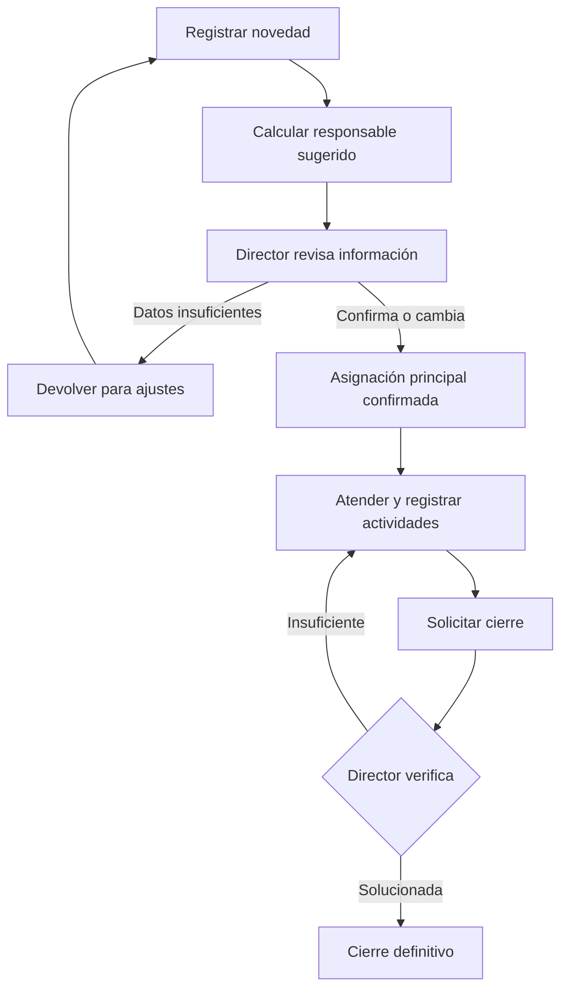
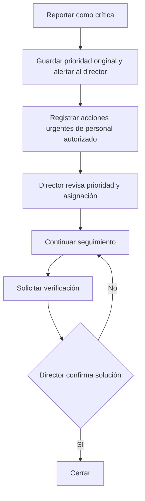
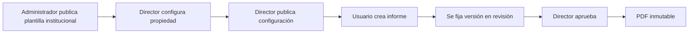
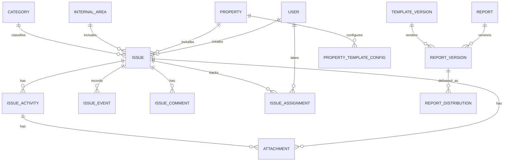

# EG S.A.S. — Sistema de Gestión de Novedades

**Especificación funcional y técnica preliminar — Documento maestro**  
**Versión de la definición:** 2.2 (consolidación documental)  
**Fecha de compilación:** 15 de octubre de 2026  
**Estado:** definición funcional avanzada; **no equivale a software desarrollado, probado o aprobado formalmente por EG S.A.S.**  
**Ámbito:** propiedades horizontales administradas por EG S.A.S. y gestión interna de EG S.A.S.  
**Exclusiones explícitas:** contabilidad, tesorería y pagos.

> **Uso de este documento.** Reúne las decisiones tomadas en las conversaciones de definición del producto, el proceso operativo presentado y los documentos de práctica aportados como contexto. Distingue las decisiones confirmadas de las recomendaciones técnicas y de los puntos abiertos. Las reglas RN-001 a RN-221 figuran en un registro histórico de trazabilidad; las decisiones posteriores prevalecen cuando una regla antigua quedó reemplazada. El contenido académico de los archivos de referencia no implica que se hayan ejecutado desarrollos o pruebas.

## Contenido

1. [Resumen y propósito](#1-resumen-y-propósito)
2. [Antecedentes y proceso actual](#2-antecedentes-y-proceso-actual-as-is)
3. [Objetivos, alcance y límites](#3-objetivos-alcance-y-límites)
4. [Actores, roles y permisos](#4-actores-roles-y-permisos)
5. [Novedades: estructura y clasificación](#5-novedades-estructura-y-clasificación)
6. [Flujo de atención y asignación](#6-flujo-de-atención-y-asignación-to-be)
7. [Actividades, seguimiento y evidencias](#7-actividades-seguimiento-y-evidencias)
8. [Notificaciones y panel de control](#8-notificaciones-y-panel-de-control)
9. [Módulo de informes](#9-módulo-de-informes)
10. [Plantillas institucionales y personalización](#10-plantillas-institucionales-y-personalización)
11. [Diseño de pantallas](#11-diseño-de-pantallas)
12. [Modelo conceptual de datos](#12-modelo-conceptual-de-datos)
13. [Arquitectura técnica propuesta](#13-arquitectura-técnica-propuesta)
14. [Requisitos no funcionales](#14-requisitos-no-funcionales)
15. [Catálogo de requisitos funcionales](#15-catálogo-de-requisitos-funcionales)
16. [Pruebas y criterios de aceptación](#16-pruebas-y-criterios-de-aceptación)
17. [Plan de implementación recomendado](#17-plan-de-implementación-recomendado)
18. [Decisiones aprobadas, propuestas y pendientes](#18-decisiones-aprobadas-propuestas-y-pendientes)
19. [Registro completo de reglas RN-001 a RN-221](#19-registro-completo-de-reglas-rn-001-a-rn-221)
20. [Glosario, fuentes y control de cambios](#20-glosario-fuentes-y-control-de-cambios)

---

## 1. Resumen y propósito

EG S.A.S. requiere una plataforma para **registrar, asignar, atender, supervisar, verificar, cerrar y consultar novedades**. Una novedad es cualquier situación que necesita atención o seguimiento, no solamente un daño técnico. El sistema atenderá dos ámbitos: (a) propiedades horizontales administradas por la empresa y (b) situaciones internas de EG S.A.S.

Actualmente, las novedades pueden quedar repartidas entre WhatsApp, correo, llamadas, fotografías y archivos. Esto dificulta conocer de forma inmediata quién responde por un caso, qué se ha hecho, qué está pendiente y con qué evidencias se cerró. La plataforma reunirá esos datos en un expediente operativo consultable desde computador o celular.

**Propuesta de producto:** aplicación web progresiva (PWA), con acceso por roles y propiedades/áreas autorizadas, estados, actividades, comentarios, archivos, notificaciones, informes PDF y exportaciones Excel. La arquitectura y las tecnologías recogidas más adelante son **propuestas** derivadas de la documentación inicial; todavía deben confirmarse con el equipo de desarrollo.

### 1.1 Principios de diseño

- Un caso conserva su identidad desde el registro hasta el cierre, incluso si cambia de responsable, prioridad o estado.
- La novedad, sus actividades y su historial son objetos relacionados, pero distintos.
- El responsable principal de la novedad es único a la vez; una novedad puede tener múltiples actividades y participantes.
- El director operativo confirma la asignación principal y realiza el cierre definitivo.
- Las novedades críticas admiten registro de atención inmediata antes de la confirmación formal, con aviso al director y trazabilidad.
- El cierre exige evidencias según la categoría configurada y verificación del director.
- El módulo de informes reutiliza los registros existentes; no altera la información original.
- Los permisos restringen **acciones** y **alcance de los datos**; tener una función administrativa no otorga automáticamente acceso a expedientes.
- La plataforma no autoriza ni ejecuta compras, movimientos de dinero, pagos ni comprobaciones financieras.

## 2. Antecedentes y proceso actual (AS-IS)

### 2.1 Situación de partida

En la descripción operativa aportada, EG S.A.S. administra propiedades horizontales y supervisa elementos como ascensores, electrobombas, luminarias, puertas eléctricas, piscinas, jardines, aseo, equipos eléctricos y áreas comunes. La operación se coordina mediante diferentes canales, en especial WhatsApp, llamadas y correo.

### 2.2 Proceso documentado de atención de un daño

| Paso | Acción actual | Interviniente habitual |
|---:|---|---|
| 1 | Inspeccionar la propiedad. | Supervisor/coordinador |
| 2 | Identificar la novedad. | Supervisor/coordinador |
| 3 | Tomar evidencia inicial. | Supervisor/coordinador |
| 4 | Reportar por WhatsApp para revisión. | Coordinador / Dirección Operativa |
| 5 | Solicitar cotización a técnico o proveedor. | Coordinador |
| 6 | Enviar cotización a Dirección. | Coordinador |
| 7 | Solicitar recursos por correo. | Dirección Operativa |
| 8 | Validar disponibilidad de recursos. | Contabilidad |
| 9 | Aprobar o negar el requerimiento financiero. | Contabilidad |
| 10 | Comunicar autorización para continuar. | Dirección Operativa |
| 11 | Entregar recursos autorizados. | Tesorería |
| 12 | Realizar la compra correspondiente. | Coordinador |
| 13 | Coordinar intervención técnica. | Coordinador |
| 14 | Ejecutar instalación o reparación. | Técnico / proveedor |
| 15 | Verificar solución y dar cierre. | Coordinador en el proceso original |

**Aclaración:** este es el proceso *actual descrito en las fuentes*, no el flujo que implementará íntegramente la plataforma. Los pasos contables y de tesorería permanecerán **fuera del sistema**. El cierre digital propuesto pasa a responsabilidad exclusiva del director, conforme a las decisiones posteriores. Tampoco todas las novedades requieren cotizaciones, compras o técnicos.

### 2.3 Problemas a resolver

- Información dispersa y difícil de recuperar.
- Falta de historial único para cada caso.
- Dificultad para ubicar responsable y estado actuales.
- Escasa visibilidad del tiempo transcurrido y de los bloqueos.
- Informes por propiedad que requieren reconstrucción manual.
- Evidencias, cotizaciones y resultados almacenados en diferentes lugares.

## 3. Objetivos, alcance y límites

### 3.1 Objetivo general

Desarrollar una plataforma web progresiva que centralice la gestión de novedades de propiedades horizontales y de áreas internas de EG S.A.S., permitiendo registrarlas, asignarlas, documentar su atención, verificar su solución y generar informes de gestión con trazabilidad.

### 3.2 Objetivos específicos

1. Registrar novedades con categorías, prioridades y datos adecuados al ámbito.
2. Gestionar responsables principales, actividades, estados, observaciones y evidencias.
3. Distinguir la atención ordinaria de las medidas inmediatas en casos críticos.
4. Controlar la verificación y el cierre definitivo por Dirección Operativa.
5. Permitir seguimiento por propiedad, área interna, responsable y periodo.
6. Generar informes automáticos con textos editables, revisión, aprobación, PDF oficial, exportación de datos y control de versiones.
7. Proteger los accesos y conservar historial de cambios, documentos y entregas.

### 3.3 Dentro del alcance funcional

- Autenticación y autorización por roles, propiedades y áreas.
- Usuarios, propiedades, zonas y áreas internas.
- Categorías y criterios de evidencia configurables.
- Novedades, asignación mixta y prioridades, incluida prioridad crítica.
- Actividades y responsables de actividad, comentarios, menciones y adjuntos.
- Estados, seguimiento, auditoría, cierre y reapertura.
- Avisos internos y bandejas de pendientes; mecanismo adicional para urgencias por concretar.
- Tableros operativos con filtros e indicadores.
- Informes por propiedad, internos y consolidados; plantillas y personalización limitada.
- Borradores, revisión y aprobación exclusivamente por el director; publicación interna.
- PDF oficial, Excel para análisis y registro de distribución externa exclusivamente por director.
- Almacenamiento privado, historial, copias de seguridad y recuperación.

### 3.4 Fuera del alcance de la primera versión

- Contabilidad, tesorería, cuentas, saldos, conciliaciones, presupuestos, control de gastos, desembolsos y pagos.
- Autorización financiera de compras, contrataciones y entrega de dinero.
- Inventario y gestión completa de compras/proveedores.
- Programación integral de mantenimiento preventivo.
- Portal de residentes o de terceros externos.
- Editor visual libre de páginas y plantillas al estilo de un procesador de documentos.
- Firmas digitales certificadas, pagos electrónicos y distribución masiva automática.
- Expedientes laborales disciplinarios o datos sensibles que requieran tratamiento especializado.
- Aplicaciones móviles nativas para tiendas de Android/iOS.

**Límite práctico:** registrar una cotización en una novedad significa conservar un soporte operativo, no administrar dinero ni aprobar financieramente su ejecución.

### 3.5 Resultado esperado del proyecto

Una primera versión operativa que pueda usarse en un piloto con usuarios reales, acompañada de especificación, pruebas, manuales básicos y procedimiento de respaldo. **No se afirma que esos entregables ya existan.**

## 4. Actores, roles y permisos

### 4.1 Roles de negocio

| Rol | Alcance y responsabilidad |
|---|---|
| **Gerente** | Crear novedades, supervisar propiedades y gestión interna, registrar observaciones, consultar tableros e informes, elaborar borradores autorizados. No aprueba ni distribuye informes oficialmente, no cierra novedades. |
| **Auxiliar de Gerencia** | Apoyo a Gerencia, registro y seguimiento dentro de permisos otorgados; acceso no necesariamente idéntico al gerente. No aprueba ni distribuye oficialmente. |
| **Director operativo** | Revisa novedades, confirma o modifica su responsable principal, supervisa actividades, cambia prioridades con trazabilidad, verifica y cierra/reabre novedades; revisa, devuelve, aprueba y distribuye oficialmente informes. Personaliza opciones permitidas de plantillas por propiedad. |
| **Coordinador operativo** | Registra novedades, aporta evidencias, atiende asignaciones, crea y distribuye actividades de sus casos, registra avances, solicita cierre y elabora informes de sus propiedades autorizadas. |
| **Administrador del sistema** | Configura cuentas, roles, permisos, catálogos y plantilla institucional. Este rol técnico no confiere automáticamente acceso a información operativa confidencial. |
| **Participante interno autorizado** | Puede atender actividades asignadas y registrar avances/evidencias, si su acceso ha sido otorgado. Su alcance exacto es propuesta técnica derivada del concepto de participantes. |
| **Técnico/proveedor externo** | Puede figurar como tercero relacionado con la intervención, **sin cuenta ni acceso** en el MVP. El responsable interno documenta su trabajo. |

### 4.2 Principios de control de acceso

1. Las funciones se conceden por rol y permisos explícitos.
2. Cada usuario tiene acceso solo a las propiedades y áreas autorizadas; Gerencia tiene visibilidad general según las políticas de la empresa.
3. Una actividad interna asignada a un coordinador no abre automáticamente todas las novedades del área interna.
4. Director: único cierre definitivo y única aprobación/distribución oficial de informes.
5. Director: confirmación o reasignación del responsable principal de novedades.
6. Director y responsable principal: creación y asignación de actividades a usuarios autorizados.
7. El administrador de plantillas institucionales no puede alterar contenido histórico aprobado.
8. El permiso para descargar un PDF no equivale a autorización para distribución oficial; fuera de la aplicación se requerirá una política interna de uso documental.

### 4.3 Matriz de operaciones principales

| Operación | Gerente | Aux. Gerencia | Director | Coordinador | Admin. sistema |
|---|:---:|:---:|:---:|:---:|:---:|
| Crear novedad | Sí | **Por confirmar** | Sí | Sí | No por defecto |
| Marcar novedad inicialmente crítica | Sí | **Por confirmar** | Sí | Sí | No por defecto |
| Ver novedades propias/autorizadas | Sí | Sí | Sí | Sí | Solo permiso adicional |
| Confirmar responsable principal | No | No | **Sí** | No | No |
| Cambiar prioridad con motivo | Proponer | Proponer | **Sí** | Proponer | No |
| Crear actividades | Solo si es responsable principal | Solo si es responsable principal | Sí | Si es responsable principal | No |
| Asignar actividades | Solo si es responsable principal | Solo si es responsable principal | Sí | Si es responsable principal | No |
| Registrar avances propios | Sí, según acceso | Sí, según acceso | Sí | Sí | No |
| Solicitar cierre | Si es responsable principal | Si es responsable principal | Sí | Si es responsable principal | No |
| Cerrar/reabrir novedad | No | No | **Sí** | No | No |
| Elaborar borrador de informe | Sí | Sí, según acceso | Sí | Sí, según acceso | No por defecto |
| Revisar para aprobación | No | No | **Sí** | No | No |
| Aprobar informe | No | No | **Sí** | No | No |
| Distribución externa oficial | No | No | **Sí** | No | No |
| Plantilla institucional | No | No | No | No | **Sí** |
| Configuración por propiedad | No | No | **Sí** | No | No |

**Pendiente real:** inicialmente se confirmó que reportan *Gerencia, Director y Coordinadores*. El Auxiliar de Gerencia se incorporó después con permisos similares a Gerencia, pero no se confirmó expresamente su facultad para crear o marcar crítica una novedad. Debe validarse; no se concede por suposición.

## 5. Novedades: estructura y clasificación

### 5.1 Dos ámbitos distintos

| Campo | Novedad de propiedad | Novedad interna |
|---|---|---|
| Ámbito | `PROPIEDAD` | `INTERNA` |
| Referencia obligatoria | Propiedad existente y autorizada | Área interna existente y autorizada |
| Ubicación complementaria | Zona, equipo o punto de referencia (si corresponde) | Oficina, dependencia o ubicación interna (si corresponde) |
| Categorías | Catálogo operativo para propiedades | Catálogo interno configurable |
| Responsable sugerido | Coordinador principal de propiedad, si existe y está activo | Referente de área interna, si existe y está activo |
| Informes | Por propiedad o consolidado | Por área o consolidado |

No se creará una propiedad ficticia llamada «EG S.A.S.» para las novedades internas. A nivel de datos, cada novedad estará relacionada con **una propiedad o un área interna, nunca ambas**.

### 5.2 Categorías sugeridas (configurables, no cerradas)

- Propiedades: mantenimiento, aseo, jardinería, seguridad, administrativa, convivencia, otras.
- Internas: administrativa, operativa, tecnología, otras.
- Las categorías podrán activarse/desactivarse; deberán conservarse en reportes históricos aunque se retiren del catálogo activo.
- Cada categoría podrá establecer evidencias mínimas para solicitar cierre.

### 5.3 Datos de una novedad

**Obligatorios comunes:** código único, ámbito, título, descripción, categoría, prioridad inicial, creador, fecha/hora de registro, estado y propiedad **o** área interna. Algunos se generan automáticamente.

**Complementarios:** ubicación/zona, equipo, fotos iniciales, archivos, responsable sugerido, responsable principal confirmado, otros participantes, fecha prevista, descripción de impacto, causa, observaciones, vínculos a casos duplicados, motivo de descarte/reapertura.

**Regla de edición:** no se borran retroactivamente los valores históricos de estados, prioridad, asignaciones o cierres. Los cambios relevantes se registran como eventos auditables.

### 5.4 Prioridad y estado son independientes

| Prioridad | Criterio orientativo |
|---|---|
| Baja | Puede programarse sin urgencia. |
| Media | Requiere seguimiento ordinario. |
| Alta | Atención preferente; **en principio requiere asignación confirmada**. |
| Crítica | Riesgo o daño grave que exige reacción inmediata; habilita registro urgente previo a confirmación. |

Gerente, director y coordinador pueden clasificar inicialmente una novedad como crítica. Solo el director modifica formalmente la prioridad y deja motivo e historial. Una marca «crítica» no autoriza ejecutar tareas de riesgo sin competencia técnica ni saltarse controles financieros fuera de la aplicación.

### 5.5 Estados principales de la novedad

| Estado | Qué significa |
|---|---|
| `REGISTRADA` | Caso creado; se valida y propone responsable. |
| `EN_REVISION` | Director revisa y confirma o devuelve por datos insuficientes. |
| `ASIGNADA` | Director confirmó responsable principal. |
| `EN_ATENCION` | Se ejecutan actividades y se documentan avances. |
| `PENDIENTE_CIERRE` | El responsable informó solución y solicita verificación. |
| `CERRADA` | Director verificó y cerró definitivamente. |

**Condiciones adicionales que no conviene confundir con estados principales:** devuelta para ajustes, en espera externa, atención urgente iniciada, reabierta y descartada. Se implementarán como subestados, indicadores, eventos o transiciones controladas según diseño técnico; su representación exacta aún es propuesta.

## 6. Flujo de atención y asignación (TO-BE)

### 6.1 Flujo ordinario



1. El usuario autorizado crea el caso; la plataforma genera código y fecha/hora.
2. Propone un responsable según propiedad/área si existe un candidato activo y autorizado.
3. El director revisa datos, prioridad y sugerencia; confirma o cambia responsable principal.
4. El responsable principal organiza la atención, crea actividades y asigna participantes autorizados; el director puede intervenir.
5. Se registran avances, evidencias y eventuales esperas externas.
6. El responsable solicita cierre cuando se cumplan los requisitos de evidencia de la categoría.
7. El director verifica, cierra o devuelve la novedad para completar la atención.

### 6.2 Asignación mixta, casos particulares

| Caso | Comportamiento |
|---|---|
| Una propiedad con coordinador principal activo | Se propone como responsable; el director confirma o cambia. |
| Propiedad con varios coordinadores | Se propone el principal configurado o se solicita selección. |
| Propiedad sin coordinador | Queda pendiente de asignación hasta intervención del director. |
| Novedad interna con responsable de área | Se propone si está activo y autorizado. |
| Usuario sugerido inactivo/no autorizado | No se confirma automáticamente; el director debe seleccionar otro. |
| Reasignación posterior | Solo director para responsable principal, con motivo y evento de auditoría. |

La sugerencia nunca equivale a asignación final para los casos ordinarios.

### 6.3 Excepción de novedad crítica



- Pueden iniciarse **registros de atención inmediata** antes de la asignación formal.
- Es obligatorio guardar responsable de la acción, fecha, descripción y evidencia cuando exista.
- El director recibe una alerta y posteriormente confirma/rectifica prioridad y asignación, con motivo.
- La atención urgente no habilita permisos técnicos o financieros adicionales.
- Incluso una novedad crítica necesita revisión y cierre definitivo del director.
- Si se rebaja la prioridad, el historial urgente permanece.

### 6.4 Devoluciones, reaperturas y descartes

- **Devolución inicial:** el reporte carece de información suficiente; el creador o usuario indicado lo completa sin perder su historia.
- **Devolución de cierre:** el director no considera resuelto el caso o faltan evidencias; exige motivo y regresa a atención.
- **Reapertura:** solo director, con causa y evento de auditoría, después de un cierre.
- **Descarte:** solo acción autorizada por el director, con motivo; no cuenta como novedad solucionada.
- **Duplicados:** propuesta de vincularlos y conservar sus registros, sin eliminarlos; regla operativa exacta pendiente.

## 7. Actividades, seguimiento y evidencias

### 7.1 Diferencias entre objetos

- **Novedad:** situación principal con código, ámbito, prioridad, estado y responsable general.
- **Actividad:** acción o tarea vinculada a una novedad; puede tener responsable, estado, fechas y archivos propios.
- **Seguimiento:** comentario, decisión, avance o evento que explica qué pasó con la novedad o sus actividades.
- **Evidencia:** archivo o constancia asociado a novedad/actividad; se organiza según su finalidad.

**Ejemplo:** una electrobomba averiada corresponde a una novedad. Inspección, solicitud de visita, reparación y verificación son actividades de ese mismo caso. No se crean cuatro novedades distintas para esas gestiones.

### 7.2 Estados de actividad

| Estado | Significado | Condiciones |
|---|---|---|
| `PENDIENTE` | No iniciada. | Puede tener fecha objetivo. |
| `EN_CURSO` | Se está realizando. | Acepta avances, comentarios y adjuntos. |
| `BLOQUEADA` | No puede continuar. | Motivo obligatorio. |
| `COMPLETADA` | Se terminó la actividad. | Fecha real, usuario y resultado. |
| `CANCELADA` | Ya no procede. | Motivo obligatorio; no se elimina el historial. |

Una actividad completada no cierra automáticamente la novedad. Si todas las actividades están listas, el responsable principal solicita el cierre y el director verifica.

### 7.3 Creación y distribución de actividades

- El director y el responsable principal pueden crear y asignar actividades.
- Los destinatarios deben ser usuarios activos y autorizados para la novedad.
- El director supervisa y puede modificar, cancelar o reasignar actividades.
- Los participantes actualizan las actividades que tengan asignadas; no pueden reasignar el responsable principal de la novedad.
- Un proveedor/técnico externo puede figurar como ejecutor informado, sin credenciales de acceso en el MVP.
- Las reasignaciones conservan usuario anterior, nuevo responsable, autor del cambio y fecha.
- Las actividades podrán tener fechas previstas y reales. El director podrá revisar retrasos y bloqueos.

### 7.4 Historial de seguimiento

Se registrará automáticamente: creación, correcciones relevantes, clasificaciones críticas, cambios de prioridad, asignaciones/reasignaciones, cambios de estado, solicitudes de cierre, devoluciones, aprobación de cierre, reaperturas, descartes, creación/cambio de actividades y registros de documentos. Los comentarios manuales también guardarán autor y fecha.

La interfaz podrá mostrar una línea de tiempo cronológica con los eventos; debe distinguir textos escritos por un usuario de cambios automáticos del sistema. No se eliminarán silenciosamente comentarios ni eventos; la política de corrección y retención será auditada.

### 7.5 Evidencias y archivos

| Tipo | Uso |
|---|---|
| Inicial | Foto/documento del problema al reportarlo. |
| Ejecución | Avances e intervenciones durante la atención. |
| Final | Resultado que apoya la verificación del cierre. |
| Soporte | Cotización, diagnóstico técnico, comunicación u otro PDF/archivo relevante. |

Los documentos se relacionarán con la novedad o con una actividad concreta. Conservarán metadatos de autor, fecha, nombre y clase de archivo, además de controles de acceso. Se deben definir formatos, tamaños máximos y un proceso de carga fiable; **los límites numéricos siguen pendientes**.

### 7.6 Requisitos de evidencia para solicitar cierre

La evidencia exigida será **configurable por categoría**. Ejemplos propuestos, no parametrización aprobada:

| Categoría | Evidencia sugerida |
|---|---|
| Mantenimiento | Foto final y descripción del trabajo. |
| Aseo/jardinería | Foto del resultado. |
| Seguridad | Prueba documental o visual según la situación. |
| Administrativa | Resultado descrito; documento cuando corresponda. |
| Otra | Regla definida por el administrador autorizado. |

El sistema validará requisitos antes de enviar a cierre; el director, con criterio operativo, comprobará el resultado. Los cambios de configuración no deben alterar silenciosamente los criterios ya aplicados a solicitudes en revisión.

## 8. Notificaciones y panel de control

### 8.1 Eventos propuestos

| Evento | Destinatario |
|---|---|
| Novedad nueva | Director que deba revisar la asignación. |
| Novedad marcada crítica | Director, con aviso prioritario. |
| Asignación confirmada/reasignación | Responsable principal. |
| Actividad nueva o reasignada | Responsable de actividad. |
| Comentario con mención | Usuario mencionado y autorizado. |
| Reporte devuelto | Usuario encargado de corregirlo. |
| Solicitud de cierre | Director. |
| Solicitud de cierre devuelta | Responsable principal. |
| Novedad cerrada | Creador y responsable. |
| Actividad bloqueada/vencida | Responsable y director según configuración. |
| Informe enviado a revisión | Director. |
| Informe devuelto | Autor del borrador. |
| Informe aprobado | Autor y usuarios autorizados. |

**MVP:** bandeja y avisos internos. **Pendiente:** canal alterno confiable para alertas críticas (correo, push o mensajería), configuración y escalamiento si el director no responde. No se presume que un aviso mostrado en pantalla garantice su lectura.

### 8.2 Tableros

- **Gerencia:** novedades por ámbito/propiedad, abiertas al corte, prioridades, críticas, cierres, tiempos, pendientes y responsables.
- **Dirección:** por revisar, sin responsable, críticas, bloqueadas, en espera, pendientes de cierre, informes por aprobar.
- **Coordinador:** propiedades asignadas, «Mis novedades», actividades asignadas, próximas a vencer y solicitudes devueltas.
- **Administrador técnico:** catálogos, usuarios, permisos, plantillas y auditoría técnica; no vista indiscriminada de expedientes.

### 8.3 Indicadores y fórmulas preliminares

| Indicador | Regla de cálculo |
|---|---|
| Novedades registradas en periodo | Casos creados entre fecha inicial y final. |
| Novedades cerradas en periodo | Casos con evento de cierre durante el intervalo. |
| Abiertas a fecha de corte | Casos que, en el instante de corte, no estaban cerrados ni descartados. |
| Actividades completadas en periodo | Actividades con fecha de finalización real en intervalo. |
| Tiempo hasta primera atención | Primera acción de atención menos fecha de registro. |
| Tiempo hasta asignación | Primera confirmación menos fecha de registro. |
| Tiempo hasta cierre | Fecha de cierre menos fecha de registro, distinguiendo reaperturas. |
| Tiempo por estado | Diferencia entre eventos sucesivos de estado, dentro del intervalo considerado. |
| Novedades críticas | Casos marcados inicialmente críticos y/o críticos en algún momento; informar el criterio usado. |
| Porcentaje de cierre de cohorte | Casos creados en periodo que ya se cerraron / casos creados en periodo; fijar fecha de corte. |

**No mezclar poblaciones:** «registradas en septiembre» y «cerradas en septiembre» son cifras de cohortes diferentes; el cociente simple entre ellas no es necesariamente una tasa de solución. En una reapertura conviene distinguir *novedades únicas cerradas* de *eventos de cierre*. Los cálculos definitivos deberán incluir casos de prueba con periodos, zonas horarias y reaperturas.

## 9. Módulo de informes

### 9.1 Tipos confirmados

1. **Propiedad:** informe de un edificio o conjunto para un periodo seleccionado, con novedades, actividad, evidencias, pendientes y observaciones.
2. **Gestión interna:** información de un área o conjunto de áreas internas autorizadas de EG S.A.S.
3. **Consolidado de Gerencia:** datos generales comparativos de propiedades y áreas, separados por ámbito cuando corresponda.

### 9.2 Elaboración: automático y editable

| Componente | Origen | Modificación desde el informe |
|---|---|---|
| Nombre de propiedad/área y periodo | Registro y filtros | Se elige al crear; no se reescribe en documento. |
| Novedades, estado, actividades, fechas, responsables | Base de datos e historial | **No editable**. |
| Indicadores y totales | Cálculos automáticos | **No editable**. |
| Selección de fotos/soportes a mostrar | Evidencias autorizadas | **Sí**, selección sin alterar origen. |
| Introducción | Autor del borrador | Sí. |
| Observaciones generales | Autor del borrador | Sí. |
| Recomendaciones | Autor del borrador | Sí. |
| Comentarios finales | Autor del borrador | Sí. |
| Identidad del aprobador y sello temporal | Sistema al aprobar | No. |

El usuario debe poder previsualizar el documento. La vista previa y el PDF aprobado se generarán a partir del mismo modelo de datos y motor de representación para reducir diferencias.

### 9.3 Estados y decisiones

| Estado | Acciones permitidas |
|---|---|
| `BORRADOR` | Editar textos, seleccionar evidencias y actualizar datos de origen explícitamente. |
| `EN_REVISION` | Ver documento congelado; el director aprueba o devuelve. Sin edición silenciosa. |
| `DEVUELTO` | Autor corrige, consulta observaciones y reenvía. |
| `APROBADO` | Documento oficial inmutable, publicado internamente para usuarios autorizados. Nueva corrección requiere versión nueva. |

La **publicación interna** ocurre automáticamente después de la aprobación; es un evento, no una segunda aprobación. **Distribuido** tampoco reemplaza al estado Aprobado: es una entrega vinculada a una versión concreta.

### 9.4 Responsabilidades exclusivas

- **Director operativo:** único revisor con facultad de aprobar/devolver, único aprobador de informes de todos los tipos y único usuario con función de distribución oficial externa.
- **Otros usuarios:** pueden elaborar y consultar según alcance autorizado, descargar cuando corresponda y agregar textos editables; no aprobar ni registrar distribución externa oficial.
- **Administrador técnico:** gestiona diseño institucional, sin acceso automático al contenido confidencial de informes.

### 9.5 Estructura base del informe de propiedad

1. Portada: identidad institucional y propiedad, título, periodo, versión.
2. Identificación: datos de propiedad, autor del informe, fecha de corte.
3. Introducción redactada (si se habilita).
4. Resumen: totales e indicadores con definiciones consistentes.
5. Relación de novedades: código, título, prioridad, estado, fechas y responsables.
6. Detalle de gestiones/actividades (opcional, con filtros definidos).
7. Evidencias seleccionadas y su descripción (opcional).
8. Novedades pendientes al corte y bloqueos (sección configurable, conservando resumen obligatorio de estados).
9. Observaciones y recomendaciones redactadas (si se habilitan).
10. Identificación de aprobación, fecha y control de versión.

Las versiones internas o consolidadas heredan identidad institucional, con estructura de contenido propia del ámbito.

### 9.6 Criterios de fechas y corte

- El periodo seleccionado limita los registros que aparecen según su fecha pertinente; el informe indicará el criterio en cada sección.
- La **fecha de corte** determina estados y pendientes a un momento concreto.
- Novedades iniciadas meses atrás pueden aparecer como cerradas en el periodo, sin cambiar su mes de registro.
- Cambios ocurridos después de que el borrador se envía a revisión no alteran automáticamente el contenido en revisión.
- Cuando un borrador requiere datos nuevos, debe ofrecer una acción explícita de actualizar, mostrando qué información cambiará.

### 9.7 Publicación y distribución

Solo se distribuyen oficialmente **versiones aprobadas**. El director registra destinatario, canal, fecha, versión exacta, responsable y observaciones/comprobante cuando aplique. La versión entregada conserva su PDF, aunque después se emita una nueva. Se distingue entre **registro manual de entrega** y un envío electrónico verificable; el MVP puede comenzar con la primera opción.

Los demás roles pueden descargar los PDF autorizados, pero la aplicación no puede impedir técnicamente que alguien reenvíe un archivo descargado. Esa limitación se cubre con autorización, auditoría y política interna de tratamiento de documentos, no con una promesa de control absoluto.

### 9.8 Versiones de documentos

1. **Versión de plantilla institucional:** estructura base publicada por el administrador.
2. **Versión de configuración por propiedad:** logo, encabezado, datos, secciones y presentación permitida; publicada por el director.
3. **Versión del informe:** instantánea de datos, textos, selecciones, evidencias y diseño; se aprueba y distribuye como documento fijo.

No se reemplazan PDFs aprobados; una corrección origina otra versión con motivo, fecha, autor y nueva aprobación. La aplicación conserva el informe anterior y sus distribuciones.

## 10. Plantillas institucionales y personalización

### 10.1 Autoridades

| Acción | Administrador | Director | Otros roles |
|---|:---:|:---:|:---:|
| Crear/modificar plantilla institucional | Sí | No | No |
| Publicar nueva versión institucional | Sí | No | No |
| Personalizar configuración de propiedad | No por defecto | Sí | No |
| Publicar configuración de propiedad | No por defecto | Sí | No |
| Editar textos de un informe propio autorizado | No por defecto | Sí | Según acceso |
| Modificar datos históricos desde plantilla | No | No | No |

### 10.2 Opciones por propiedad

- Logo de propiedad (opcional; si no existe, usar imagen/identidad institucional).
- Nombre, dirección, identificación registrada y datos de contacto autorizados.
- Secciones opcionales visibles y su orden dentro de límites institucionales.
- Opciones de disposición de imágenes (por ejemplo, una o dos por fila).
- Identificación y pie de página común; no se eliminan campos de control del documento.

### 10.3 Secciones inalterables y opcionales

**Obligatorias:** identificación del informe, ámbito/propiedad/área, periodo y fecha de corte, resumen de novedades y estados, identificador/versión, aprobador y fecha de aprobación en la versión final.

**Opcionales:** introducción, detalle extendido de actividades, galería fotográfica, pendientes detallados, observaciones generales, recomendaciones y comentarios finales. Ocultar una sección del PDF no elimina sus registros del sistema.

### 10.4 Flujo de configuración



La plantilla institucional, configuración por propiedad y documento final tienen historiales distintos. El cambio de plantilla no altera informes aprobados ni enviados a revisión. Los borradores podrán actualizarse expresamente a una nueva plantilla publicada.

### 10.5 Generación de PDF

Proceso propuesto: (1) elegir ámbito/periodo; (2) recuperar datos autorizados; (3) generar instantánea temporal; (4) resolver plantilla institucional y configuración particular; (5) construir vista previa; (6) enviar a director; (7) aprobar; (8) producir y conservar PDF inmutable; (9) habilitar descarga/registro de distribución. La selección concreta del motor PDF deberá probarse contra documentos con muchas fotografías, tablas extensas y caracteres en español.

El Excel será una **exportación de datos**, no una reproducción visual de la maqueta PDF. Se recomiendan hojas separadas de novedades, actividades y resumen, con columnas documentadas y filtros, sin replicar información financiera.

## 11. Diseño de pantallas

Las pantallas siguientes representan una **propuesta de organización funcional**, no prototipos diseñados ni aplicaciones ya construidas.

### 11.1 Navegación general

```text
EG S.A.S. — Gestión de Novedades
├── Inicio / Tablero
├── Novedades
│   ├── Todas (según permisos)
│   ├── Mis novedades
│   ├── Pendientes de revisión
│   ├── Críticas / en espera / vencidas
│   ├── Nueva novedad
│   └── Detalle
│       ├── Resumen
│       ├── Actividades
│       ├── Evidencias y documentos
│       ├── Comentarios
│       └── Historial
├── Propiedades
│   ├── Catálogo, zonas y responsables
│   └── Configuración de informes (solo director)
├── Gestión interna
│   ├── Áreas
│   └── Novedades autorizadas
├── Informes
│   ├── Crear y previsualizar
│   ├── Mis borradores
│   ├── Por revisar / devueltos
│   ├── Aprobados / histórico
│   └── Distribuciones (solo director)
└── Configuración
    ├── Usuarios, roles, asignaciones y catálogos
    ├── Prioridades y evidencias por categoría
    ├── Plantilla institucional (solo admin)
    └── Auditoría técnica
```

### 11.2 Pantalla «Nueva novedad»

1. Elegir **Propiedad horizontal** o **Interna EG S.A.S.**.
2. Mostrar propiedad/zona o área interna según elección.
3. Completar título, descripción, categoría y prioridad; opcionalmente adjuntos iniciales.
4. Identificar al creador automáticamente y sugerir responsable si corresponde.
5. Si se marca crítica, mostrar aviso claro de atención inmediata y enviar alerta al director.
6. Permitir guardar y confirmar recepción; gestionar pérdida de señal sin duplicar registros.

### 11.3 Pantalla de detalle

Encabezado: código, título, ámbito, prioridad, estado, responsable principal y fechas. Secciones: descripción, actividades, comentarios, evidencias, eventos y solicitudes de cierre. Las acciones disponibles dependerán del rol, del estado y de la asignación.

### 11.4 Bandejas por usuario

- **Director:** registros por revisar, casos sin asignar, críticos, pendientes de cierre, informes en revisión.
- **Coordinador/responsable:** casos y actividades asignados, vencimientos, devoluciones, bloqueos.
- **Gerencia:** vista consolidada, casos críticos, análisis por propiedad y áreas.

### 11.5 Informes y plantillas

- Creador de informe: ámbito → destinatario interno (propiedad/área) → periodo → secciones → vista previa.
- Editor de borrador: textos redactados y selección de evidencias, manteniendo métricas bloqueadas.
- Revisión del director: PDF de vista previa, comentarios, devolver o aprobar.
- Histórico: versión, fecha, autor, aprobador, PDF oficial y entregas.
- Configuración de plantilla: campos institucionales gestionados por admin y configuración particular gestionada por director.

## 12. Modelo conceptual de datos

Este modelo es una **propuesta inicial**, no un esquema Prisma ni una migración aprobada. Los nombres pueden ajustarse al idioma y estilo de implementación, sin perder las relaciones.

### 12.1 Entidades

| Entidad | Información principal | Relación |
|---|---|---|
| `User` | Identificación interna, nombre, correo/login, estado activo | Roles, propiedades, áreas, acciones y tareas |
| `Role` / `Permission` | Rol y capacidad autorizada | Usuarios |
| `Property` | Nombre, datos identificativos, dirección, estado | Zonas, responsables, novedades, configuración PDF |
| `PropertyAssignment` | Usuario, propiedad, función, principal o apoyo | Control de acceso y sugerencias |
| `PropertyZone` | Zona/equipo/ubicación dentro de propiedad | Novedades |
| `InternalArea` | Nombre, referencia y responsable opcional | Novedades internas y permisos |
| `AreaAssignment` | Usuarios autorizados para área y función | Áreas/usuarios |
| `Category` | Ámbito, nombre, actividad, reglas de evidencia | Novedades |
| `ClosureEvidencePolicy` | Tipos de soporte requeridos y versión | Categorías/solicitudes de cierre |
| `Issue` | Código, ámbito, título, prioridad, estado, creador, fechas, propietario o área | Actividades, adjuntos, historial |
| `IssueAssignment` | Responsable, autor, motivo y vigencia | Novedad y usuarios |
| `IssueParticipant` | Participante interno con permiso | Novedad |
| `IssueActivity` | Título, descripción, responsable, estado, vencimiento y cierre | Novedad y eventos |
| `IssueComment` | Texto, creador, fecha, menciones | Novedad/actividad |
| `Attachment` | Tipo, propósito, clave de almacenamiento, autor, tamaño, hash | Novedad/actividad/informe |
| `IssueEvent` | Tipo de cambio, autor, instante, valores relevantes | Historial de la novedad |
| `Notification` | Destinatario, evento, leído, fecha | Usuarios y recursos |
| `Report` | Tipo, ámbito, periodo, creador, estado | Versiones y revisiones |
| `ReportVersion` | Instantánea, plantilla, versión, aprobador, archivo final | Informe, entregas |
| `ReportReview` | Revisión, observaciones, decisión | Informe/versión |
| `ReportDistribution` | Versión entregada, destinatario, canal, fecha, responsable | Informe aprobado |
| `TemplateVersion` | Plantilla institucional versionada y publicada | Informes |
| `PropertyTemplateConfig` | Personalización por propiedad, versión y publicación | Propiedad/plantilla |
| `AuditEvent` | Actor, acción, recurso, fecha, datos de cambio | Sistema completo |

### 12.2 Restricciones a proteger desde base de datos

- `Issue.scope = PROPIEDAD` exige `property_id` y prohíbe `internal_area_id`.
- `Issue.scope = INTERNA` exige `internal_area_id` y prohíbe `property_id`.
- Código de novedad único.
- Un responsable principal **vigente** por novedad, sin eliminar el historial de anteriores.
- No asignar participantes inactivos o no autorizados (validación de servicio transaccional).
- No permitir cierre definitivo fuera de la transición validada para director.
- Las evidencias y eventos históricos serán append-only o tendrán sustitución auditada.
- Una versión aprobada de informe es inmutable; la siguiente corrección crea otra versión.
- Las distribuciones apuntan a una **versión** de informe aprobada, no solo al informe lógico.
- La versión de plantilla/configuración usada para un informe queda fijada.
- No borrar en cascada registros operativos por retirar usuarios, categorías o propiedades; preferir desactivación.

### 12.3 Relaciones conceptuales



### 12.4 Auditoría y temporalidad

Se recomienda usar instantes de tiempo en UTC en la base de datos y convertir para visualización a la zona de EG S.A.S. (Colombia). Las fechas de corte deben interpretarse explícitamente. Los eventos importantes deben conservar el actor y un contexto verificable para reconstruir cambios.

## 13. Arquitectura técnica propuesta

### 13.1 Stack de referencia de las fuentes (aún por ratificar)

| Capa | Tecnología propuesta | Motivo |
|---|---|---|
| Frontend | Angular como PWA | Acceso desde navegador y celular, componentes y posibilidad de instalación. |
| Backend | NestJS con API REST | Separación de módulos, validaciones y políticas de autorización. |
| Base de datos | PostgreSQL | Integridad referencial y transacciones para estados, responsables y versiones. |
| Arquitectura de backend | Monolito modular | Separación de responsabilidades con despliegue sencillo. |
| Despliegue | Docker Compose, Nginx, HTTPS en VPS | Operación inicial contenida y centralizada. |
| Archivos | Almacenamiento privado en VPS o servicio de objetos equivalente | Fotografías, documentos y PDF accesibles solo por permisos. |
| Autenticación | Tokens/sesiones seguros, control de roles y permisos | Identificación de usuario y protección de recursos. |
| PDF | Motor HTML/CSS a PDF u otra biblioteca validada | Aprovechar plantillas y vista previa consistente. |

**Divergencia de fuentes:** el plan inicial propone Cloudinary para fotos y VPS para PDF. Otro informe también recoge almacenamiento híbrido. No está acordada una decisión final sobre proveedor, cuotas o política de alojamiento de imágenes. Es correcto conservar la alternativa como pendiente y no fijarla sin análisis de costos, privacidad y respaldos.

### 13.2 Separación modular recomendada

```text
backend/
├── identity-and-access
├── properties-and-areas
├── catalog-and-evidence-policies
├── issues
├── activities-and-comments
├── attachments
├── notifications
├── reporting-and-indicators
├── templates-and-report-versions
├── report-distribution
└── audit
```

La separación modular no implica necesariamente microservicios independientes. Las operaciones que afectan a varias tablas —por ejemplo, confirmación de asignación, solicitud de cierre o aprobación de informe— requieren transacciones y protección frente a solicitudes concurrentes.

### 13.3 Integraciones y almacenamiento

- Acceso autenticado a los archivos, sin enlaces públicos permanentes.
- Política de nombres/claves de almacenamiento, límites y validación de tipo real del archivo.
- Almacenamiento y base de datos respaldados de forma consistente; prueba periódica de restauración.
- Generación de informes fuera del proceso de petición si los PDF son grandes; proceso asíncrono y estado de generación como **propuesta de implementación**, no requisito comercial ya aprobado.
- Considerar límites de tamaño para fotografías desde celular y compresión sin perder evidencia relevante.
- Despliegue de pruebas separado del entorno productivo.

### 13.4 PWA y modo sin conexión

Las fuentes académicas incluyen un objetivo de diligenciar reportes sin conexión y sincronizarlos después. **No fue validado expresamente en la conversación de definición actual**. Se recomienda tratarlo como requisito propuesto y decidir si entra en el MVP; implementarlo correctamente requiere almacenamiento local seguro, reintentos idempotentes, prevención de duplicados y gestión de conflictos.

## 14. Requisitos no funcionales

| Código | Requisito | Estado |
|---|---|---|
| RNF-01 | Cifrado en tránsito (HTTPS), contraseñas almacenadas con hash resistente y autenticación segura. | Propuesto/consistente con fuentes |
| RNF-02 | Autorización por rol y alcance en backend, incluso si la interfaz oculta funciones. | Necesario por decisiones |
| RNF-03 | Protección de archivos y validación de cargas contra acceso indebido y contenido peligroso. | Propuesto |
| RNF-04 | Historial de auditoría de cambios sensibles, aprobaciones, cierres y distribución. | Confirmado funcionalmente |
| RNF-05 | Interfaz adaptable a computador y celular; navegación PWA. | Confirmado como enfoque |
| RNF-06 | Manejo de errores y recuperación de conexiones interrumpidas sin registros duplicados. | Propuesto |
| RNF-07 | Copias de seguridad de base de datos, evidencias, PDF y configuración, con pruebas de restauración. | Confirmado como necesidad |
| RNF-08 | Protección de datos personales y minimización de información recopilada. | Propuesto/necesario |
| RNF-09 | Disponibilidad, tiempos de respuesta y tamaño de archivos con metas medibles acordadas antes de pruebas. | **Valores pendientes** |
| RNF-10 | Monitoreo, registros de errores y observabilidad mínima de backend y generación de informes. | Propuesto |
| RNF-11 | Soporte de accesibilidad básica, contraste, teclado, mensajes claros y formularios utilizables. | Propuesto |
| RNF-12 | Configuración segura de servidor, copias y credenciales por ambiente. | Propuesto |
| RNF-13 | Inmutabilidad lógica de documentos aprobados y referencias a versiones de plantilla. | Confirmado funcionalmente |
| RNF-14 | Pruebas automatizadas de permisos, flujos, transiciones y generación de documentos. | Necesario para validación |
| RNF-15 | No almacenar ni procesar saldos, datos contables o pagos. | Restricción confirmada |
| RNF-16 | Política de conservación y eliminación legal de información por definir con EG S.A.S. | Pendiente |

No se establecen SLA, número de usuarios concurrentes, límites exactos ni plazos de retención sin datos de la operación real.

## 15. Catálogo de requisitos funcionales

Los requisitos funcionales (RF) siguientes presentan el **alcance consolidado** y son la referencia preferida para diseñar módulos. El registro RN posterior conserva la trazabilidad de las decisiones tomadas durante la conversación.

| Código | Requisito verificable |
|---|---|
| RF-001 | Autenticar usuarios y aplicar permisos por rol, propiedad, área interna y participación. |
| RF-002 | Administrar usuarios y activar/desactivar accesos sin borrar historiales. |
| RF-003 | Registrar propiedades, zonas, coordinadores principales y usuarios autorizados. |
| RF-004 | Registrar áreas internas y responsables sugeribles. |
| RF-005 | Administrar categorías por ámbito y sus requisitos de evidencia para cierre. |
| RF-006 | Crear novedades de propiedad o internas con datos y validaciones diferenciados. |
| RF-007 | Generar código único, creador y fecha de registro automáticamente. |
| RF-008 | Clasificar novedades por prioridad, incluida crítica desde su creación por roles confirmados. |
| RF-009 | Proponer responsable según configuración del ámbito. |
| RF-010 | Permitir al director confirmar, modificar y reasignar responsable principal con historial. |
| RF-011 | Rechazar candidatos inactivos/no autorizados y dejar pendientes los casos sin sugerencia válida. |
| RF-012 | Gestionar transiciones de estado y devoluciones sin pérdida de historial. |
| RF-013 | Permitir registrar atención urgente antes de asignación en novedades críticas. |
| RF-014 | Alertar al director al crearse o reclasificarse una novedad crítica. |
| RF-015 | Registrar motivos y autores de cambios de prioridad. |
| RF-016 | Permitir a director y responsable principal crear actividades. |
| RF-017 | Permitirles asignar actividades a usuarios activos autorizados. |
| RF-018 | Administrar estados de actividades y fechas objetivo/reales. |
| RF-019 | Exigir motivo al bloquear o cancelar actividades. |
| RF-020 | Registrar comentarios, menciones autorizadas y avances fechados. |
| RF-021 | Adjuntar y consultar fotografías, documentos y cotizaciones como soportes. |
| RF-022 | Clasificar adjuntos como iniciales, ejecución, finales o soporte. |
| RF-023 | Exigir evidencias de cierre según categoría y versión de regla aplicable. |
| RF-024 | Permitir a responsable principal solicitar cierre. |
| RF-025 | Permitir solo al director verificar, cerrar, devolver o reabrir con motivo. |
| RF-026 | Conservar historial cronológico de cambios de novedades y actividades. |
| RF-027 | Mostrar bandejas de tareas, casos críticos, asignaciones y solicitudes pendientes por rol. |
| RF-028 | Notificar eventos relevantes a usuarios autorizados. |
| RF-029 | Mostrar tableros por propiedad, área, prioridad, responsable y estado. |
| RF-030 | Calcular indicadores según fechas reales de eventos y fecha de corte. |
| RF-031 | Generar borradores de informes por propiedad, área interna y consolidado. |
| RF-032 | Recuperar automáticamente novedades, actividades e indicadores del periodo seleccionado. |
| RF-033 | Editar introducciones, observaciones, recomendaciones y otras secciones habilitadas. |
| RF-034 | Seleccionar evidencias autorizadas para incluir en el informe sin alterar archivos originales. |
| RF-035 | Guardar borradores y permitir actualizar explícitamente sus datos de origen. |
| RF-036 | Mostrar vista previa coherente con el PDF destinado a aprobación. |
| RF-037 | Enviar informe a revisión fijando la versión de contenido, datos y plantilla. |
| RF-038 | Permitir únicamente al director devolver con observaciones o aprobar. |
| RF-039 | Publicar internamente el PDF inmutable al aprobar, con control de acceso. |
| RF-040 | Generar una nueva versión para corregir un informe ya aprobado. |
| RF-041 | Consultar histórico de versiones y decisiones de revisión/aprobación. |
| RF-042 | Registrar distribución oficial externa solo por el director, vinculada a versión aprobada. |
| RF-043 | Exportar datos autorizados a Excel sin cambiar el contenido del PDF oficial. |
| RF-044 | Crear, versionar y publicar plantillas institucionales solo por administrador. |
| RF-045 | Personalizar y publicar configuraciones de plantilla por propiedad solo por director. |
| RF-046 | Aplicar configuración institucional por defecto si no hay personalización válida. |
| RF-047 | Conservar referencias de versiones de plantilla/configuración en cada PDF. |
| RF-048 | Registrar auditoría de cierres, asignaciones, informes, plantillas y distribuciones. |
| RF-049 | Filtrar consultas y exportaciones conforme al alcance del usuario. |
| RF-050 | Permitir respaldos y restauración documentada de información y archivos. |

## 16. Pruebas y criterios de aceptación

### 16.1 Novedades, permisos y flujo

| ID | Escenario | Resultado esperado |
|---|---|---|
| CP-01 | Coordinador crea novedad en propiedad asignada. | Se guarda con código, ámbito, fecha y autor; propone candidato. |
| CP-02 | Coordinador intenta crear/consultar en propiedad no autorizada. | Se deniega la operación en backend. |
| CP-03 | Crea novedad interna. | Exige área; no acepta simultáneamente propiedad. |
| CP-04 | No hay responsable sugerible. | Queda en revisión; no se asigna a usuario aleatorio. |
| CP-05 | Director confirma asignación. | Se notifica al responsable y queda evento de auditoría. |
| CP-06 | Coordinador intenta cambiar responsable principal. | Acceso denegado. |
| CP-07 | Caso crítico se registra antes de asignación. | Alerta al director; registra medidas urgentes autorizadas. |
| CP-08 | Director cambia prioridad crítica a media. | Motivo obligatorio y conservación de prioridad inicial/acciones urgentes. |
| CP-09 | Responsable principal crea actividad y asigna usuario autorizado. | Actividad registrada, responsable notificado. |
| CP-10 | Intenta asignar a usuario inactivo o sin alcance. | Operación rechazada. |
| CP-11 | Actividad se marca bloqueada. | Exige motivo y conserva historial. |
| CP-12 | Categoría exige foto final y se solicita cierre sin ella. | Solicitud impedida con mensaje claro. |
| CP-13 | Responsable solicita cierre con evidencias suficientes. | Pasa a pendiente de cierre. |
| CP-14 | Coordinador intenta cerrar definitivamente. | Acceso denegado. |
| CP-15 | Director devuelve cierre con motivo. | Regresa a atención y deja evento. |
| CP-16 | Director cierra y luego reabre con motivo. | Se preserva el cierre histórico y el evento de reapertura. |
| CP-17 | Desactivar una categoría con casos anteriores. | Historial de casos permanece legible. |

### 16.2 Informes, plantillas y distribución

| ID | Escenario | Resultado esperado |
|---|---|---|
| CP-18 | Usuario genera borrador por propiedad. | Datos y evidencias autorizados correctos; periodo visible. |
| CP-19 | Cambia texto de observaciones en borrador. | Modifica informe, nunca novedad de origen. |
| CP-20 | Intenta cambiar un indicador automático en editor. | Campo bloqueado; cálculo intacto. |
| CP-21 | Envía borrador a revisión. | Instantánea fija; no cambia ante nuevos eventos posteriores. |
| CP-22 | Director devuelve con observaciones. | Autor puede corregir y reenviar; decisión registrada. |
| CP-23 | Gerente intenta aprobar. | Rechazo por permisos. |
| CP-24 | Director aprueba un informe. | Se conserva PDF oficial y se publica para usuarios autorizados. |
| CP-25 | Se cambia una novedad tras aprobación. | PDF oficial histórico sin cambios. |
| CP-26 | Se solicita corregir aprobado. | Se crea nueva versión y exige aprobación nueva. |
| CP-27 | Coordinador intenta distribuir oficialmente. | Acceso denegado. |
| CP-28 | Director distribuye versión 1 y luego se aprueba versión 2. | La entrega histórica sigue apuntando a versión 1. |
| CP-29 | Administrador publica nueva plantilla institucional. | Nuevos documentos usan nueva versión; los anteriores no cambian. |
| CP-30 | Director personaliza logo de una propiedad. | Solo afecta a la propiedad configurada y a informes nuevos. |
| CP-31 | Director intenta modificar una sección institucional obligatoria. | No se permite. |
| CP-32 | Usuario intenta leer un PDF de otra propiedad por URL directa. | Rechazo por autorización en servidor. |
| CP-33 | Informe tiene decenas de fotografías/tablas. | PDF no corta contenido y mantiene legibilidad. |
| CP-34 | Informe combina registradas/cerradas de otros meses. | Indicadores aplican fechas y cohortes correctas. |
| CP-35 | Dos usuarios intentan aprobar/versionar en paralelo. | No se producen versiones finales inconsistentes. |

### 16.3 Pruebas transversales

- Intentos de modificar datos de otro ámbito por URL o parámetros de API.
- Archivos demasiado grandes, formatos falsos y archivos maliciosos.
- Recuperación de copia de seguridad y consistencia entre archivos/metadatos.
- Registros con fechas en límites de mes y zona horaria Colombia.
- Flujo con reaperturas, descartes y casos sin evidencia fotográfica por categoría.
- Conexión móvil intermitente; si se aprueba modo offline, sincronización duplicada y conflictos.
- Revisión de la correspondencia entre la vista previa y el PDF generado/aprobado.

## 17. Plan de implementación recomendado

### 17.1 Entregas técnicas por orden de dependencia

| Etapa | Contenido | Evidencia de término |
|---|---|---|
| 0. Validación | Resolver políticas pendientes y normalizar reglas. | Documento aprobado por responsables de EG S.A.S. |
| 1. Base | Proyecto, autenticación, usuarios, roles, propiedades y áreas. | Acceso y aislamiento comprobados. |
| 2. Novedades | Catálogos, alta, estados, prioridades y asignación mixta. | Ciclo ordinario validado. |
| 3. Operación | Actividades, evidencias, comentarios, historial, urgencias. | Casos completos y pruebas de autorización. |
| 4. Cierre/avisos | Evidencia por categoría, solicitud/cierre, bandejas y notificaciones. | Flujo crítico y ordinario comprobados. |
| 5. Informes | Borradores, métricas, PDF, Excel, editor de secciones. | Informe correcto para propiedad e interno. |
| 6. Gobierno documental | Plantillas/versiones, revisión, aprobación y distribuciones. | Histórico inmutable y permisos comprobados. |
| 7. Piloto y entrega | Pruebas de aceptación, respaldo, capacitación, ajustes. | Acta de validación y procedimiento operativo. |

### 17.2 Cronogramas de fuentes: discrepancia abierta

Los dos informes de práctica aportados presentan enfoques temporales diferentes: uno incluye un cronograma de **nueve semanas** y el otro uno de **dieciséis semanas**. Ninguno se toma aquí como plazo contractual del producto. EG S.A.S. debe validar la fecha real de inicio/fin de la práctica y el calendario de desarrollo antes de convertir las etapas anteriores en cronograma.

### 17.3 Entregables a crear posteriormente

- Especificación funcional validada y matriz final de permisos.
- Diagramas BPMN del proceso actual y propuesto, si el informe académico los requiere.
- Modelo entidad-relación y migraciones.
- Prototipos de pantallas escritorio/móvil.
- Contratos de API y arquitectura revisada.
- Casos de pruebas implementados y resultados.
- Instructivo de operación, copias/restauración y manuales por rol.
- Acta de aprobación del alcance y de cierre del piloto.

## 18. Decisiones aprobadas, propuestas y pendientes

### 18.1 Confirmadas expresamente en esta conversación

| ID | Decisión | Estado |
|---|---|---|
| DEC-01 | Novedades de propiedades **y** novedades internas de EG S.A.S. | Confirmada |
| DEC-02 | Puede reportarse cualquier situación que necesite seguimiento. | Confirmada |
| DEC-03 | Reportan Gerencia, director y coordinadores. | Confirmada |
| DEC-04 | Solo el director realiza el cierre definitivo. | Confirmada |
| DEC-05 | Asignación mixta; sugerencia del sistema y confirmación/cambio por director. | Confirmada |
| DEC-06 | Atención inmediata registrable para casos críticos antes de confirmar asignación. | Confirmada |
| DEC-07 | Gerencia, director y coordinadores pueden marcar inicialmente una novedad crítica; director ajusta con historial. | Confirmada |
| DEC-08 | Director y responsable principal crean/asignan actividades; director supervisa. | Confirmada |
| DEC-09 | Requisitos de evidencia para cierre configurables por categoría; director verifica. | Confirmada |
| DEC-10 | Informes automáticos con secciones redactadas editables, sin cambiar datos originales. | Confirmada |
| DEC-11 | Director aprueba todos los informes. | Confirmada |
| DEC-12 | Solo director realiza distribución externa oficial. | Confirmada |
| DEC-13 | Plantilla institucional configurable por propiedad. | Confirmada |
| DEC-14 | Administrador gestiona plantilla institucional; director configura opciones permitidas por propiedad. | Confirmada |
| DEC-15 | Contabilidad y tesorería quedan fuera del sistema. | Confirmada |

### 18.2 Decisiones técnicas o de operación propuestas, NO aprobadas expresamente

- Un único responsable principal activo por novedad.
- Posibilidad de elaborar informes por coordinadores y Gerencia bajo los alcances propuestos.
- Publicación automática interna tras aprobación del director.
- Estados técnicos exactos, parámetros de vencimiento y mecanismo de alertas críticas.
- Política de categorías por defecto y requisitos concretos de fotos/documentos.
- Almacenamiento de fotos (VPS o servicio externo) y motor concreto de PDF.
- Modo sin conexión y sincronización avanzada de PWA.
- Activación de reportes de gestión interna para determinados usuarios adicionales.

Estas propuestas aparecen desarrolladas en las reglas de negocio acumuladas, pero conviene validarlas como un bloque antes del diseño final.

### 18.3 Pendientes de decisión

| ID | Pregunta pendiente | Riesgo si no se define |
|---|---|---|
| PEN-01 | ¿Puede el director aprobar un informe que elaboró él mismo? | Flujo de revisión sin criterio en autorrevisión. |
| PEN-02 | ¿Qué sucede si el director no está disponible? ¿Se puede designar otro usuario que tenga formalmente ese mismo rol? | Informes y cierres detenidos. |
| PEN-03 | ¿Puede Auxiliar de Gerencia registrar novedades y marcarlas críticas? | Diferencia de permisos con Gerencia. |
| PEN-04 | ¿Puede distribuirse externamente un informe interno o consolidado, y a qué destinatarios? | Posible difusión indebida. |
| PEN-05 | ¿Quién revisa las configuraciones publicadas por el director cuando afectan identidad de una propiedad? | Cambios no deseados en informes. |
| PEN-06 | ¿Cuáles son límites por prioridad y cuándo una alerta crítica escala? | Avisos inefectivos o métricas imprecisas. |
| PEN-07 | ¿Qué tipos/tamaños de archivo admite el sistema y dónde se almacenan? | Costos, seguridad y rendimiento. |
| PEN-08 | ¿Qué tiempo se conservarán documentos, eventos y archivos? | Riesgos operativos y normativos. |
| PEN-09 | ¿El MVP incluye funcionamiento sin conexión? | Complejidad adicional de sincronización. |
| PEN-10 | ¿Cuántas propiedades, coordinadores, áreas y novedades habrá inicialmente? | Dimensionamiento insuficiente. |
| PEN-11 | ¿Quién valida oficialmente los requisitos, los informes y la prueba piloto por EG S.A.S.? | Falta de criterio de aceptación. |
| PEN-12 | ¿Las categorías y sus evidencias mínimas exactas serán las sugeridas o cambiarán? | Cierres bloqueados o demasiado laxos. |
| PEN-13 | ¿Quién puede descartar casos y vincular duplicados, y en qué situaciones? | Inconsistencias en reportes. |
| PEN-14 | ¿Cómo se gestionan datos confidenciales en novedades internas? | Exposición de información sensible. |
| PEN-15 | ¿Qué periodos exactos, indicadores obligatorios y formato institucional se usarán? | Informes no aceptados por la empresa. |

### 18.4 Reglas que deben considerarse reemplazadas o precisadas

1. **Asignación principal:** una propuesta previa permitía asignaciones por Gerencia y Auxiliar de Gerencia; prevalece la decisión posterior de **confirmación/reasignación por director**.
2. **Cierre:** el flujo actual descrito en fuentes terminaba con cierre del coordinador; el flujo nuevo exige **cierre por director**.
3. **Aprobación financiera:** el plan original incorporaba Contabilidad y Tesorería en la plataforma; se descartó expresamente. Solo pueden conservarse soportes y referencias operativas.
4. **Revisión de informes:** cualquier mención a «revisor genérico» se restringe al **director** para aprobar o devolver.
5. **Distribución:** cualquier referencia a «usuario autorizado» para distribución oficial externa se restringe a **director**.
6. **Plantillas:** administración institucional es del **administrador**, configuración de propiedad es del **director**.
7. **Informes:** publicación interna es consecuencia de aprobación; distribución es evento independiente, no otro estado de aprobación.
8. **Rendimiento/sin conexión:** afirmaciones cuantitativas y modo offline de textos preliminares no se declaran implementados ni aprobados sin validación.

---

## 19. Registro completo de reglas RN-001 a RN-221

Este catálogo conserva el **historial consolidado y normalizado** de las 221 reglas numeradas durante las definiciones funcionales. No pretende ser una transcripción literal palabra por palabra. Algunas reglas antiguas quedaron precisadas o reemplazadas por decisiones posteriores (véase §18.4); en conflicto, **prevalece la decisión más reciente**. El catálogo RF-001 a RF-050 del §15 es la vista funcional depurada para el equipo de desarrollo.

### RN-001 a RN-030: Registro general, ámbitos y primeros permisos

| Código | Descripción vigente o nota histórica |
|---|---|
| RN-001 | Toda novedad tendrá un identificador único generado automáticamente. |
| RN-002 | Solo roles autorizados podrán registrar novedades: Gerencia, Dirección y Coordinadores (Auxiliar de Gerencia por validar). |
| RN-003 | Toda novedad tendrá ámbito propiedad o gestión interna, con relación exclusiva a una propiedad o un área. |
| RN-004 | Datos mínimos: título, descripción, categoría, ámbito y referencia; sistema guarda fecha y creador. |
| RN-005 | Los usuarios accederán solo a propiedades y áreas autorizadas; Gerencia tiene visibilidad general según política. |
| RN-006 | El director confirma al responsable principal de cada novedad; otros roles pueden solicitar cambios pero no confirmarlos. |
| RN-007 | Cada novedad tendrá un responsable principal vigente y puede tener participantes. |
| RN-008 | Prioridades baja, media, alta o crítica; plazos máximos por configurar. |
| RN-009 | Los usuarios autorizados registran avances, comentarios, fechas, fotos y documentos. |
| RN-010 | Los cambios relevantes se guardan con autor, fecha y valores; no desaparecen silenciosamente. |
| RN-011 | Si existe dependencia externa, se registra motivo y condición de espera. |
| RN-012 | El coordinador o responsable principal solicita cierre; no cierra definitivamente. |
| RN-013 | El director verifica solución y evidencias antes del cierre, según categoría. |
| RN-014 | El director puede devolver el cierre con motivo, preservando historial. |
| RN-015 | Las novedades cerradas no se editan como abiertas; reapertura autorizada deja motivo. |
| RN-016 | Los descartes se conservan con justificación y no se cuentan como soluciones ejecutadas. |
| RN-017 | Informes respetan permisos y filtros de ámbito, propiedad, responsable, estado y periodo. |
| RN-018 | Se excluyen operaciones contables, presupuestos, pagos y tesorería. |
| RN-019 | Se pueden adjuntar cotizaciones como soporte, sin registro de saldos o pagos. |
| RN-020 | Toda novedad conserva historial, aun reasignada, devuelta, reabierta o cerrada. |
| RN-021 | Las novedades de propiedad requieren propiedad válida. |
| RN-022 | Las novedades internas requieren área válida y no llevan propiedad. |
| RN-023 | Las categorías son configurables y se diferencian por ámbito. |
| RN-024 | La visibilidad depende de rol, propiedades y participación en casos internos. |
| RN-025 | Participar en una novedad interna no da acceso a todas las del área. |
| RN-026 | La propuesta temprana concedía asignación a Gerencia/Auxiliar; queda sustituida por confirmación y reasignación principal del director. |
| RN-027 | El director realiza el cierre definitivo en ambos ámbitos. |
| RN-028 | Los informes admiten filtros por ámbito, área, propiedad, responsable, estado y fecha. |
| RN-029 | Correcciones de ámbito requieren autorización y auditoría; no se cambian silenciosamente. |
| RN-030 | Los ámbitos comparten flujo, pero sus indicadores se consultan por separado. |

### RN-031 a RN-044: Asignación mixta

| Código | Descripción vigente o nota histórica |
|---|---|
| RN-031 | Al registrar novedad se intenta sugerir responsable por propiedad o área. |
| RN-032 | La sugerencia no es definitiva hasta confirmación del director. |
| RN-033 | El director puede cambiar el candidato propuesto por otro usuario autorizado. |
| RN-034 | Sin candidato válido, la novedad queda pendiente de asignación. |
| RN-035 | Solo usuarios activos y autorizados pueden ser responsables. |
| RN-036 | Asignaciones y reasignaciones guardan autor, fecha y responsable anterior. |
| RN-037 | Al confirmar asignación se notifica al responsable. |
| RN-038 | Cada novedad tiene un responsable principal vigente y admite participantes autorizados. |
| RN-039 | Solo el director reasigna el responsable principal de una novedad abierta, con motivo. |
| RN-040 | El responsable puede registrar impedimentos sin cerrar o eliminar el caso. |
| RN-041 | El responsable principal puede solicitar cierre; solamente el director lo confirma. |
| RN-042 | El director que devuelve solicitud de cierre registra el motivo y retorna a atención. |
| RN-043 | El sistema calcula duración de etapas a partir de eventos y fechas. |
| RN-044 | No puede asignarse un caso a alguien sin acceso a su propiedad o área. |

### RN-045 a RN-061: Novedades críticas y atención inmediata

| Código | Descripción vigente o nota histórica |
|---|---|
| RN-045 | Casos de prioridad baja, media y alta requieren confirmación antes de atención formal. |
| RN-046 | Casos críticos permiten registrar acciones inmediatas antes de la confirmación del director. |
| RN-047 | Crear novedad crítica genera alerta prioritaria al director correspondiente. |
| RN-048 | Las acciones urgentes guardan actor, fecha, descripción y evidencias disponibles. |
| RN-049 | Solo personal autorizado realiza actuaciones urgentes dentro de sus competencias. |
| RN-050 | El director revisa las acciones urgentes, confirma asignación y define pendientes. |
| RN-051 | Atención inmediata no aprueba compras, contrataciones, pagos o recursos. |
| RN-052 | Cambio de prioridad registra valores anterior y nuevo, motivo y autor. |
| RN-053 | La novedad crítica también necesita verificación y cierre por el director. |
| RN-054 | Los informes pueden identificar críticas, tiempo de respuesta y medidas previas a asignación. |
| RN-055 | Gerencia, director y coordinadores pueden clasificar inicialmente una novedad como crítica. |
| RN-056 | La creación de una crítica dispara notificación inmediata al director. |
| RN-057 | Solo el director cambia formalmente la prioridad y documenta el motivo. |
| RN-058 | Se conserva la prioridad original y cada cambio con fecha y usuario. |
| RN-059 | Bajar prioridad no borra acciones urgentes realizadas. |
| RN-060 | Marcar crítica no habilita automáticamente trabajos técnicos riesgosos ni aprobaciones financieras. |
| RN-061 | Una crítica acepta registros urgentes antes de asignación formal. |

### RN-062 a RN-076: Actividades y seguimiento

| Código | Descripción vigente o nota histórica |
|---|---|
| RN-062 | Una novedad puede contener varias actividades relacionadas con su solución. |
| RN-063 | Toda actividad tiene título, descripción, estado y autor de creación. |
| RN-064 | Una actividad puede tener responsable y fecha prevista. |
| RN-065 | El responsable principal mantiene la responsabilidad general aunque existan participantes. |
| RN-066 | Responsables internos de actividad necesitan acceso; intervenciones externas se documentan por usuario interno. |
| RN-067 | Una actividad puede incluir comentarios, fotos y documentos. |
| RN-068 | Los cambios de estado de actividad quedan en el historial. |
| RN-069 | Actividad bloqueada exige motivo. |
| RN-070 | Actividad cancelada conserva datos y motivo. |
| RN-071 | Completar todas las actividades no cierra automáticamente la novedad. |
| RN-072 | El responsable principal solicita verificación para cerrar. |
| RN-073 | El director puede devolver el caso aunque todas las actividades estén completadas. |
| RN-074 | El historial muestra cambios de prioridad, estados, responsables, actividades y cierre. |
| RN-075 | Usuarios ven y modifican actividades según su autorización. |
| RN-076 | Los informes distinguen novedades de actividades para no duplicar casos. |

### RN-077 a RN-091: Permisos y gestión de actividades

| Código | Descripción vigente o nota histórica |
|---|---|
| RN-077 | Director y responsable principal pueden crear actividades. |
| RN-078 | Ambos pueden asignar actividades a usuarios activos autorizados. |
| RN-079 | El director puede modificar, reasignar o cancelar actividades; registra motivos según corresponda. |
| RN-080 | Responsable principal administra actividades de su novedad sin cambiar el principal del caso. |
| RN-081 | Actividad tiene responsable, descripción, estado y fecha; fecha objetivo cuando corresponda. |
| RN-082 | Responsable de actividad puede actualizarla y adjuntar evidencia. |
| RN-083 | Reasignación de actividad conserva responsable anterior e historial. |
| RN-084 | Director puede consultar actividades de casos bajo su supervisión. |
| RN-085 | Completar actividad no significa por sí solo solucionar novedad. |
| RN-086 | Comentarios y avances guardan fecha, hora y autor. |
| RN-087 | Cambios de estado y responsable generan eventos automáticos. |
| RN-088 | Comentarios pueden mencionar usuarios autorizados y notificarles. |
| RN-089 | Cambios/cancelaciones no borran historial de actividades. |
| RN-090 | Actividades vencidas/bloqueadas aparecen en bandejas de responsable y director. |
| RN-091 | Se distingue fecha objetivo de fecha real de ejecución. |

### RN-092 a RN-101: Evidencias e informes iniciales

| Código | Descripción vigente o nota histórica |
|---|---|
| RN-092 | Las novedades y actividades aceptan fotos y documentos. |
| RN-093 | Archivos se clasifican como evidencia inicial, ejecución, final o soporte. |
| RN-094 | Cada archivo conserva autor, fecha y referencia al caso/actividad. |
| RN-095 | Archivos se consultan solo mediante autorización. |
| RN-096 | Eliminar/sustituir evidencia requiere trazabilidad y restricciones. |
| RN-097 | Informes se generan por ámbito, propiedad, área, responsable, categoría, estado y periodo. |
| RN-098 | Informes se exportan a PDF y Excel conforme al permiso. |
| RN-099 | Indicadores utilizan datos y fechas trazables de novedades/actividades. |
| RN-100 | Las novedades cerradas conservan evidencias, comentarios, actividades e historial. |
| RN-101 | Indicadores cuentan casos sin duplicación por múltiples actividades. |

### RN-102 a RN-108: Criterios de evidencia para cierre

| Código | Descripción vigente o nota histórica |
|---|---|
| RN-102 | Cada categoría tiene requisitos configurables de evidencia de cierre. |
| RN-103 | Requisitos admiten fotos, documentos, resultados redactados o combinaciones. |
| RN-104 | Antes de solicitar cierre se valida el cumplimiento de requisitos configurados. |
| RN-105 | Director verifica solución y suficiencia de evidencias antes de cerrar. |
| RN-106 | Director devuelve con motivo si faltan evidencias o la solución no es suficiente. |
| RN-107 | Cambios de requisitos se auditan y no alteran silenciosamente solicitudes ya iniciadas. |
| RN-108 | Archivos, observaciones y decisiones quedan en historial de cierre. |

### RN-109 a RN-122: Informes e indicadores

| Código | Descripción vigente o nota histórica |
|---|---|
| RN-109 | Hay informes por propiedad, gestión interna y consolidado de Gerencia. |
| RN-110 | Informes se generan desde novedades, actividades, evidencias e historial. |
| RN-111 | Usuario elige periodo y filtros permitidos. |
| RN-112 | Informe por propiedad solo contiene información de propiedad seleccionada. |
| RN-113 | Informe interno solo incluye áreas autorizadas. |
| RN-114 | Usuario elige qué secciones opcionales incluir. |
| RN-115 | Informe presenta estados, actividades realizadas y pendientes. |
| RN-116 | Indicadores usan fecha de registro, ejecución, estado y cierre según cada métrica. |
| RN-117 | Caso puede figurar en informes de varios periodos sin duplicarse en BD. |
| RN-118 | Existe vista previa del informe antes de generarlo. |
| RN-119 | Informe permite PDF y Excel según alcance. |
| RN-120 | Fotos/documentos incluidos respetan acceso del usuario. |
| RN-121 | Informe identifica periodo y fecha de generación. |
| RN-122 | Informes multiámbito o multipropiedad requieren autorización apropiada. |

### RN-123 a RN-140: Elaboración y revisión de informes

| Código | Descripción vigente o nota histórica |
|---|---|
| RN-123 | Informes automáticos usan registros autorizados como fuente de datos. |
| RN-124 | Solo se editan textos habilitados y se seleccionan evidencias sin modificar origen. |
| RN-125 | Indicadores, fechas, estados y datos operativos no son editables desde informes. |
| RN-126 | Cada informe tiene código, periodo, fecha de corte, autor y estado. |
| RN-127 | Los borradores se pueden guardar antes de revisión. |
| RN-128 | Se puede enviar un borrador al director para revisión. |
| RN-129 | La revisión con facultad de devolver o aprobar corresponde exclusivamente al director. |
| RN-130 | Devolución de informe registra motivo, fecha y usuario. |
| RN-131 | Cambios durante elaboración/revisión conservan trazabilidad. |
| RN-132 | Informe aprobado queda protegido ante edición directa. |
| RN-133 | Corrección posterior a aprobación crea nueva versión, preservando la anterior. |
| RN-134 | Cada versión aprobada fija datos/documentos usados. |
| RN-135 | PDF oficial y exportación Excel de datos se descargan según permisos. |
| RN-136 | Solo usuarios autorizados consultan o descargan informes de sus ámbitos. |
| RN-137 | Aprobación registra aprobador y fecha. |
| RN-138 | Informes en revisión o devueltos generan avisos a responsables. |
| RN-139 | Aprobar informe no cambia estados de novedades ni actividades. |
| RN-140 | Actualizar datos de borrador debe ser explícito y respetar textos redactados. |

### RN-141 a RN-160: Aprobación, publicación, versiones y entrega

| Código | Descripción vigente o nota histórica |
|---|---|
| RN-141 | Solo el director puede aprobar informes de cualquiera de los ámbitos. |
| RN-142 | Gerencia, Auxiliar y Coordinadores pueden elaborar informes según autorización. |
| RN-143 | Un informe únicamente puede aprobarse desde estado En revisión. |
| RN-144 | Aprobación conserva usuario, fecha, hora y versión. |
| RN-145 | Director puede devolver informe con observaciones obligatorias. |
| RN-146 | Aprobado queda disponible automáticamente para usuarios internos autorizados. |
| RN-147 | Aprobado no admite modificaciones directas. |
| RN-148 | Corrección posterior crea nueva versión y requiere nueva aprobación. |
| RN-149 | Histórico identifica versión vigente y versiones anteriores. |
| RN-150 | Cada versión aprobada conserva copia fija de datos/contenido. |
| RN-151 | Consulta/descarga restringida por ámbito y permisos. |
| RN-152 | PDF es documento oficial; Excel representa datos exportados para análisis. |
| RN-153 | Distribución se registra sobre informes aprobados; permiso concretado más adelante como exclusivo del director. |
| RN-154 | Distribución apunta a la versión específica entregada. |
| RN-155 | Se registran destinatario, canal, fecha y usuario que distribuye. |
| RN-156 | Distribuir no cambia estados de novedades o actividades. |
| RN-157 | Se preserva trazabilidad de aprobaciones, versiones y entregas. |
| RN-158 | Versiones históricas no se eliminan mediante operaciones habituales. |
| RN-159 | Archivos se protegen por controles de acceso y copias de seguridad. |
| RN-160 | Tiempo de conservación se establecerá según política documental de EG S.A.S. |

### RN-161 a RN-168: Distribución externa exclusiva del director

| Código | Descripción vigente o nota histórica |
|---|---|
| RN-161 | Solo director registra/ejecuta distribución externa oficial. |
| RN-162 | Solo informes aprobados pueden distribuirse oficialmente. |
| RN-163 | Toda distribución vincula versión específica de informe. |
| RN-164 | Distribución registra destinatario, canal, fecha, responsable y observaciones cuando existan. |
| RN-165 | Gerencia, Auxiliar y Coordinadores descargan según permisos, sin función oficial de distribución. |
| RN-166 | Historial de distribuciones se conserva tras nuevas versiones. |
| RN-167 | Aprobación y distribución son acciones diferentes, ambas exclusivas del director. |
| RN-168 | Informes en revisión o borrador no pueden figurar como distribuidos oficialmente. |

### RN-169 a RN-184: Plantillas y PDF

| Código | Descripción vigente o nota histórica |
|---|---|
| RN-169 | Existe plantilla institucional base para informes de EG S.A.S. |
| RN-170 | Plantilla institucional se adapta a informes de propiedad, internos y consolidados. |
| RN-171 | Solo usuarios con permiso institucional modifican plantillas; decisión final: administrador del sistema. |
| RN-172 | Plantilla admite logo, encabezado, pie y secciones predefinidas. |
| RN-173 | Informe incorpora automáticamente datos autorizados del periodo. |
| RN-174 | Usuarios autorizados eligen evidencias y editan secciones de texto habilitadas. |
| RN-175 | Borrador conserva los textos escritos por usuario. |
| RN-176 | La vista previa corresponde al contenido que verá el director al aprobar. |
| RN-177 | El PDF debe distribuir tablas y fotografías en páginas sin cortes inapropiados. |
| RN-178 | Las imágenes mantienen proporción y textos siguen legibles. |
| RN-179 | Informe aprobado conserva versión de plantilla utilizada. |
| RN-180 | Cambiar plantilla no altera informes aprobados anteriores. |
| RN-181 | PDF final identifica código, versión, periodo y fecha correspondiente. |
| RN-182 | PDF almacenado aprobado es el distribuible posteriormente. |
| RN-183 | Editar aprobado exige nueva versión y aprobación. |
| RN-184 | PDF y anexos se conservan en almacenamiento protegido con respaldos. |

### RN-185 a RN-206: Personalización por propiedad

| Código | Descripción vigente o nota histórica |
|---|---|
| RN-185 | Hay plantilla institucional base. |
| RN-186 | Cada propiedad admite configuración particular basada en ella. |
| RN-187 | Personalización de propiedad: logo, identificación y secciones opcionales permitidas. |
| RN-188 | Las configuraciones particulares no suprimen secciones obligatorias. |
| RN-189 | Sin configuración particular se usa la predeterminada institucional. |
| RN-190 | Identificación de la propiedad procede de su registro del sistema. |
| RN-191 | Solo administrador administra plantilla institucional. |
| RN-192 | La configuración por propiedad exige rol del director operativo. |
| RN-193 | Modificación de plantilla/configuración registra autor, fecha y cambios. |
| RN-194 | Plantillas tienen versiones y estado borrador/publicada. |
| RN-195 | Los cambios no sustituyen automáticamente versión publicada; deben publicarse. |
| RN-196 | Informes nuevos usan plantilla y configuración publicadas correspondientes. |
| RN-197 | Cambios de plantilla no alteran aprobados. |
| RN-198 | Borradores pueden actualizar a plantilla más nueva mediante acción explícita. |
| RN-199 | Informes enviados a revisión fijan diseño, datos y textos examinados. |
| RN-200 | Aprobados conservan referencias a versiones de plantilla/configuración usadas. |
| RN-201 | Ocultar imágenes en PDF no borra evidencias de la novedad. |
| RN-202 | Internos y consolidados usan identidad institucional sin propiedad ficticia. |
| RN-203 | Vista previa muestra encabezados, secciones, fotografías y páginas. |
| RN-204 | Generación PDF/Excel aplica permisos de ámbito y acceso. |
| RN-205 | Si faltan datos opcionales, se usa valor alterno razonable o se omite sin inventar. |
| RN-206 | Configurar informe no permite alterar estados, responsables ni indicadores del caso. |

### RN-207 a RN-221: Permisos definitivos de administración y publicación

| Código | Descripción vigente o nota histórica |
|---|---|
| RN-207 | Solo administrador crea, modifica, versiona y publica plantillas institucionales. |
| RN-208 | Director modifica la configuración de informes de propiedades bajo su autorización. |
| RN-209 | Personalización de propiedad se limita a opciones expuestas por plantilla institucional. |
| RN-210 | Director no puede eliminar secciones obligatorias ni editar fórmulas/datos históricos mediante personalización. |
| RN-211 | Propiedad hereda configuración institucional si no tiene una particular válida. |
| RN-212 | Configurar propiedad registra versiones, fecha y usuario. |
| RN-213 | Configuración por propiedad se guarda primero como borrador y la publica el director. |
| RN-214 | Solo configuraciones publicadas se aplican automáticamente a nuevos informes. |
| RN-215 | Actualizar plantilla/configuración no altera informes aprobados ni en revisión. |
| RN-216 | Cada versión de informe conserva qué plantilla/configuración se utilizó. |
| RN-217 | Director es único aprobador de informes de todos los ámbitos. |
| RN-218 | Informe aprobado se publica automáticamente para consulta interna autorizada. |
| RN-219 | Director es único responsable de registrar distribución externa oficial. |
| RN-220 | PDF aprobado y sus datos de aprobación se conservan sin alteración directa. |
| RN-221 | Cambios de administración/publicación de plantillas se auditan. |

## 20. Glosario, fuentes y control de cambios

### 20.1 Glosario

| Término | Definición |
|---|---|
| Novedad | Caso reportado que necesita atención o seguimiento. |
| Ámbito | Contexto del caso: propiedad horizontal o gestión interna. |
| Responsable sugerido | Candidato propuesto automáticamente; no es asignación definitiva. |
| Responsable principal | Persona que responde por el seguimiento general del caso. |
| Actividad | Trabajo o gestión específica que forma parte de una novedad. |
| Evidencia | Foto, archivo o descripción que apoya un hecho o un resultado. |
| Cierre definitivo | Decisión del director de dar por solucionado el caso. |
| Informe | Documento de gestión construido a partir de datos operativos. |
| Plantilla institucional | Diseño y estructura base publicados por el administrador. |
| Configuración por propiedad | Personalización autorizada publicada por el director. |
| Versión de informe | Instantánea de contenido y diseño de un documento aprobado. |
| Distribución oficial | Registro formal del envío/entrega externa de un PDF aprobado. |
| PWA | Aplicación web que puede ofrecer experiencia similar a una aplicación instalable. |
| RBAC | Control de acceso basado en roles. |
| MVP | Primera versión funcional acotada para validar con usuarios. |
| AS-IS / TO-BE | Proceso descrito actualmente / proceso propuesto. |

### 20.2 Documentos aportados como contexto

1. **`Proceso_Operativo.docx`**: descripción de inspecciones, reporte, cotización, solicitud de recursos, atención y cierre; base principal del proceso AS-IS de 15 pasos.
2. **`Plan_de_Mejora_Henry_Tordecilla.pdf`**: problema de dispersión de información y propuesta inicial de PWA con Angular, NestJS, PostgreSQL y módulos operativos. En su propuesta original incluyó interacción con Contabilidad y Tesorería, **posteriormente excluida** del producto confirmado.
3. **`FORMATO INFORME_PRACTICA_NORMA_IEE (1).docx`**: esquema de informe académico de práctica, alcance inicial y cronograma de nueve semanas.
4. **`FORMATO INFORME_PRACTICA_NORMA_IEE (2).docx`**: desarrollo más amplio del proceso, requisitos, propuesta técnica, flujo de informes y cronograma de dieciséis semanas. Algunos apartados están escritos en futuro o contienen marcadores «COMPLETAR» y «ACTUALIZAR»; **no se consideran resultados verificados**.
5. **Conversación de definición funcional de EG S.A.S.**: decisiones explícitamente confirmadas de la plataforma, consolidadas en §18.1 y en las reglas de este documento.

Las fuentes se utilizan **como material de contexto y diseño**. No se verificaron datos legales de EG S.A.S., métricas de producción, existencia de despliegue, resultados de pruebas, número de propiedades ni identidad legal completa.

### 20.3 Cambios consolidados en esta versión

| Versión | Cambio documental |
|---|---|
| v1.0–v1.3 (conversación) | Alcance, roles, ámbitos, asignación mixta y excepción crítica. |
| v1.4–v1.6 (conversación) | Actividades, evidencia por categoría, indicadores y estructura de informes. |
| v1.7–v1.9 (conversación) | Borradores, aprobación, distribución, versiones, PDF y plantillas. |
| v2.0–v2.1 (conversación) | Configuración por propiedad, separación de permisos y revisión de consistencia. |
| **v2.2 (este documento)** | Consolidación integral para desarrollo; catálogo RF, registro RN-001 a RN-221, datos, pruebas, decisiones y pendientes. |

### 20.4 Estado de aprobación

**Decisiones del usuario confirmadas:** DEC-01 a DEC-15 del §18.1.  
**Aprobación formal de EG S.A.S.:** pendiente.  
**Implementación y pruebas del software:** no acreditadas por este documento.  
**Próximo entregable sugerido:** historias de usuario con criterios medibles, diagrama de datos validado y prototipos de pantallas a partir de esta especificación.
